# Remaster mode for the browser game

OPTIONS > VIDEO has a REMASTER row. Ticked, the game is drawn by three's
WebGPU renderer with three things the retail page does not have:

- the sun casts real-time shadows, from everything onto everything;
- the water reflects the sky and the sun, shows its bed in the shallows
  and foams at the shore;
- explosions, muzzle flashes and tracers are light: their cores bloom and
  they light the ground and walls around them.

Everything else is drawn as the retail page draws it: the same combines at
the art's own brightness, the level's own sky and fog. Unticked (the
default) the page is the retail-parity build it always was.

Status: built 2026-11-12 and 13 on the branch `claude/remaster-browser-c4f0dd`.
Not merged.

**How it got to this shape.** The first cut (2026-11-12) relit the whole
game: physically based surfaces under a sun and the sky's image-based light,
a physical sky, a height haze, generated relief maps and a spatial audio
chain. The owner played it three times. First: "I'd keep the sun and the
water, but I'm not sold on anything else"; the relief read as hail damage
and the audio as "like having headphones on". Second: the weapon in the
hand lit by the new sun "makes everything look rubbery and low detail";
back-lit things were grey blobs, shadows "ugly and lacking light and
detail", the fog "dirty, not atmospheric". Every one of those was the
relighting: BF1942's art is painted to be seen under the engine's own
combines. So every surface went back to its combine, with the cast shadow
put inside the combine's sun term. Third (2026-11-13): "it looks nice, and
it's smooth"; what they like is the water, the shadows, and most of all the
flak gun's explosion; everything else looks about the same. So the remaster
was packaged as the one toggle and everything that was off by default or
only there for comparison was removed ("What was removed", below).

## Plan and progress

| Step | State |
|---|---|
| OPTIONS > VIDEO's REMASTER row, kept per browser, taken by the next level; `?remaster` / `?remaster=0` on the address for one page | done |
| three r186's WebGPU build through the import map when it is on; the default path untouched | done |
| WebGPU renderer under the whole game: shims for the WebGL-only calls, warm-up, node frame, overlay passes (first-person arms, replays), side views (tank sights, previews, the proving ground) | done |
| Every surface drawn with the engine's own combine, the sun's real-time shadow in its sun term: terrain, lightmapped statics, vehicles, soldiers, trees | done |
| Real-time cascaded sun shadows out to the fog's end, static casters merged into shadow proxies | done |
| The level's own painted sky (or cube) in HDR, and its own fog mixed as the retail page mixes it | done |
| Water from the level's own water words and depth bake, drawn before every other transparent thing | done |
| Foliage: leaf sprites, far cards and wind as node graphs | done |
| Bloom on muzzle flashes, explosions and tracers; flashes and blasts light their surroundings; sun shafts; ambient occlusion; SMAA | done |
| The first-person arms and weapon drawn by the engine's own combine | done |
| Pipelines and textures warmed before play; nothing built during play holds a frame | done (first kill of a kind: 283-486 ms down to about 30 ms) |
| A round thrown from the hand takes the world's material | done |
| Simplified to the one toggle: relief maps, audio chain, height haze, physical sky and every comparison flag removed | done (2026-11-13) |
| Two levels with before/after captures and frame times | done: Wake, Battle of Britain |

## How to turn it on

OPTIONS > VIDEO > REMASTER, on the menu or in a game (Escape). It is a tick
box under ANTI-ALIASING, on a ninth line of the page's own (the file's eight
are taken), kept in the browser (`localStorage` `bf42-mesh-remaster`), off
until ticked, and cleared by DEFAULT. The renderer and the three build are
chosen as a page loads, so a change made in a game waits for the next level,
and the row says so (`NEXT LEVEL`), as ANTI-ALIASING and LIGHTMAPS do. It
needs WebGPU: in a browser without it the row is not drawn and nothing turns
the remaster on.

Under the plate, wherever the row is drawn, three lines say what it is (the
owner, 2026-11-13: "as a user I'd want to know: wtf is it?"):

```
REMASTER: VISUAL IMPROVEMENTS BY SKANDIA @ BFSTATS.IO
SUN SHADOWS, REFLECTIVE WATER, EXPLOSIONS THAT LIGHT THE GROUND
REQUIRES WEBGPU AND A CAPABLE GPU: A FRAME COSTS ABOUT 2.5X
```

The last line is the measured cost ("Frame time"), not a hardware list: the
remaster has only been timed on an M5 Max.

The other rows under the remaster: SHADOWS turns the sun's shadows on and
off, at once (the retail page's own shadow pass, `shadow-pass.js`, is GLSL
on the WebGL renderer and does not run). ANTI-ALIASING does nothing: the
frame is smoothed by SMAA. TEXTURE QUALITY does nothing: textures keep their
full mips. The engine's tree sway (`geom::Swayer`) is left to the remaster's
own wind.

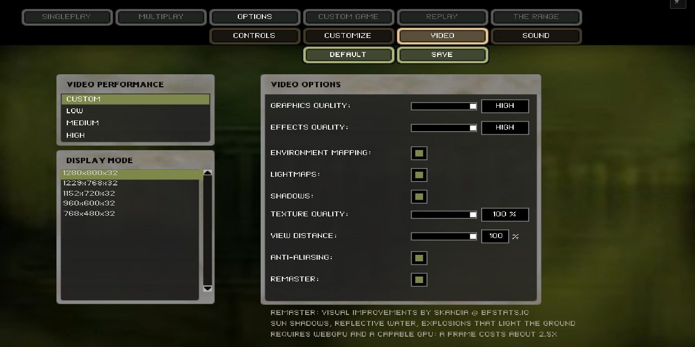

For a comparison or a harness, the address decides for one page whatever is
stored:

```
map.html?map=wake&remaster       # on
map.html?map=wake&remaster=0     # off
```

There are no other switches. Two query words are left for measuring:
`&pipelineSalt=<n>` folds a number into every fogged shader so the OS's
shader cache has seen none of them, and `&gpuTiming` asks the renderer for
timestamp queries.

The before/after harness, one headless Google Chrome with WebGPU on the Mac's
GPU (`apple metal-3`), both modes, named views per level, frame times and
captures:

```
cd tools/bf1942-models
python3 serve_viewer.py 5390 &
node tests/perf/remastershot.mjs --map wake --out /tmp/shots --modes 'retail;remaster' --frames 60
node tests/perf/remastershot.mjs --map wake --views bunker --effect 'BombBig_Expl@1328,107.5,-1192@4'
node tests/perf/remaster_explosions.mjs --base http://localhost:5390 --map wake
```

The first stops the page's own animation loop and steps frames with
`__renderOnce`, waiting for the GPU queue after each one, so a frame time is
CPU and GPU together. The last destroys vehicles, plays every explosion and
throws what the kit throws, and fails on a frame over 100 ms or a frame that
throws.

In the mesh image the pages are stamped to versioned URLs
(`mesh/stamp-viewer.mjs`). The remaster's import map is written by a script
and is not stamped: `three.webgpu.js`, `three.tsl.js` and four addons load
from their plain addresses (revalidated on each visit), and what they
import by relative path picks the version up from the page's own map.
Checked on a stamped copy served locally, both modes: one copy of three in
each. The r169 build's preload is still fetched under the remaster, unused.

## Before and after

Same camera, same level, retail on the left, remaster on the right, 1600 x 900.

Wake, the airfield ridge across the lagoon:
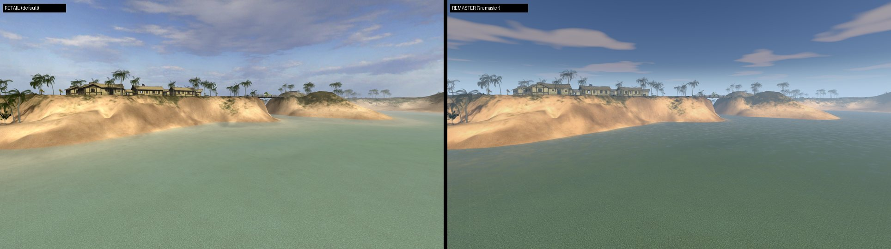

Wake, looking into the sun: the painted sky kept, the sun's glint across the
water, and the shafts:
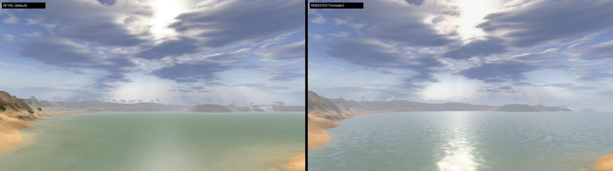

Wake, the supply bunker:
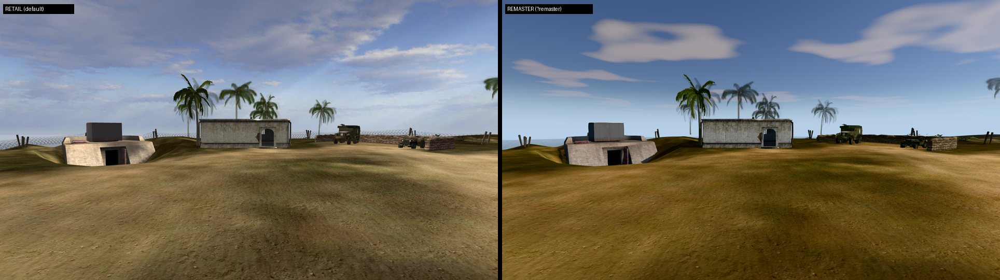

Wake from the air, over the causeway:
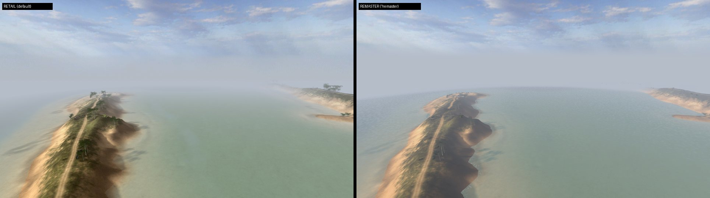

Wake, the beach below the hill. The ridge's palms throw long shadows down the
slope toward the eye:
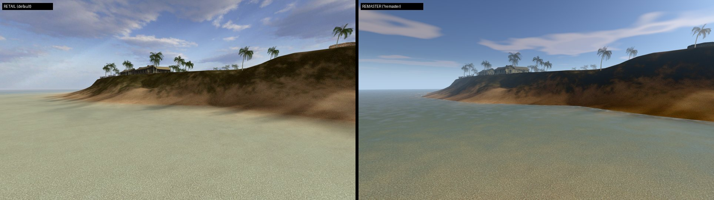

Battle of Britain, the Allied base. The tower and the posts throw real shadows:
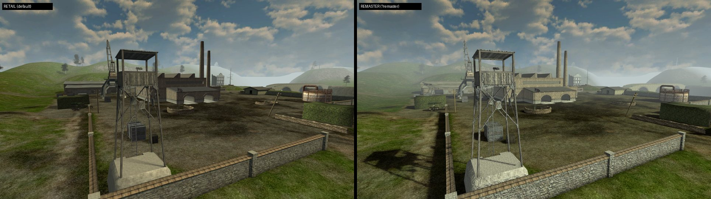

Battle of Britain, the bridge over the valley. The girders shadow the deck:
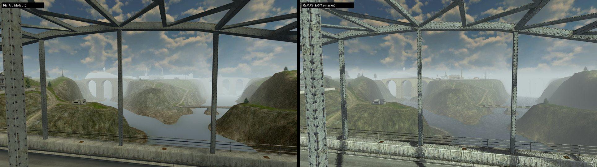

Battle of Britain, the airfield and the overview:
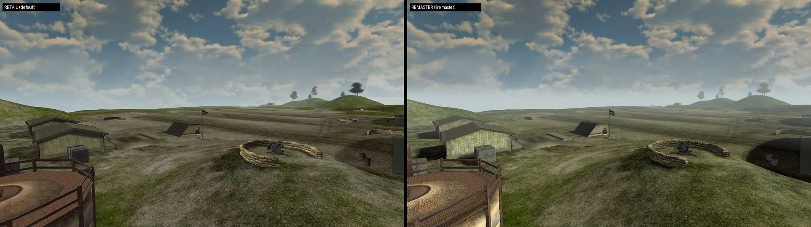
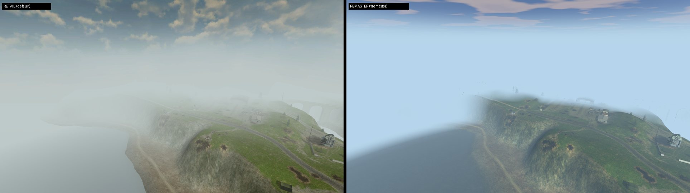

An explosion (`BombBig_Expl`, 4/30 s in) and a muzzle flash (`e_MuzzHeavy`):
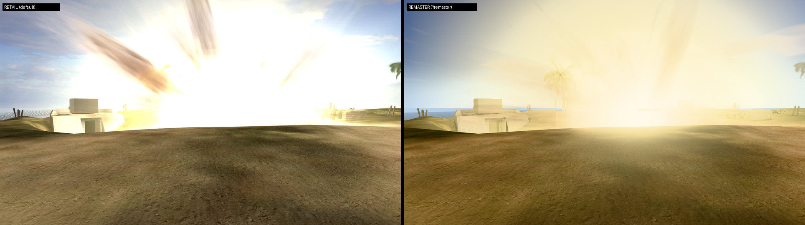
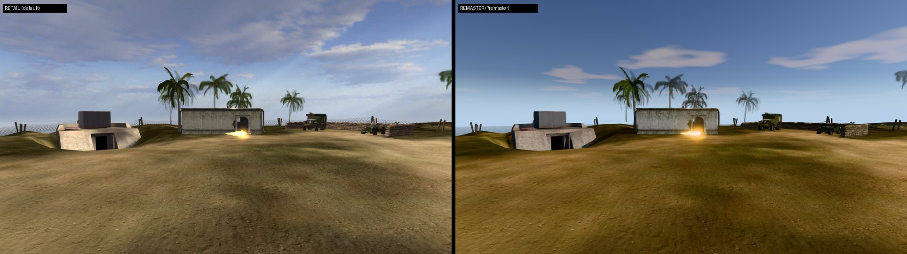

The first-person weapon at three headings on Wake (toward the sun, across
it, away from it): the original game, the remaster lighting it with its own
sun, and the remaster now, drawing it with the engine's combine:
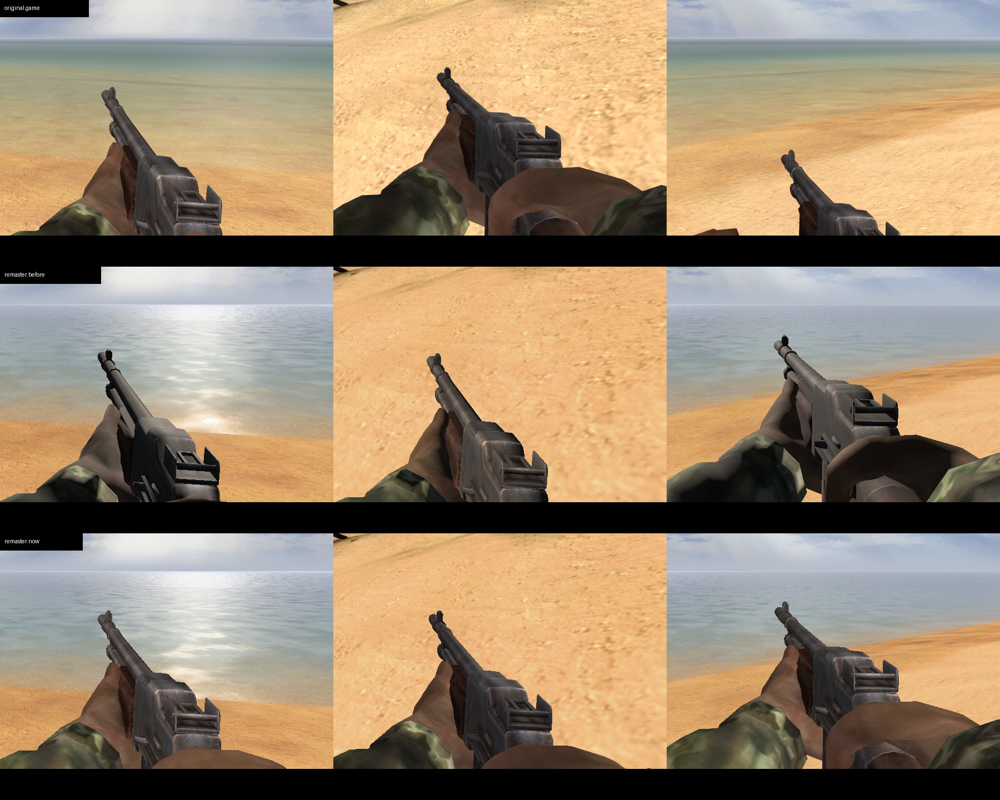

An explosion's fireball, a frame after a gun emplacement dies off the left
edge: the original game, the remaster's hard-edged rectangle, and now:
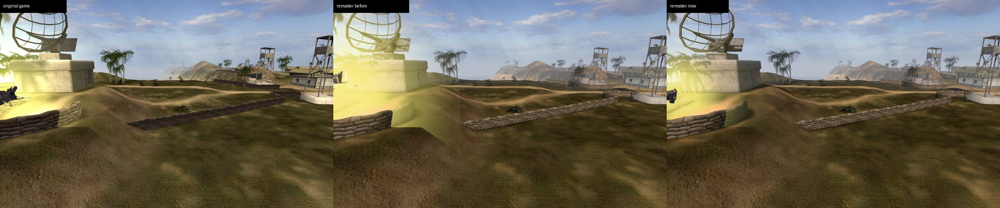

What the owner pointed at on 2026-11-13, each as the original game, the
remaster before that day and the remaster now. The Shokaku's island and
masts against the sun, a Sherman's shaded side at the north village, and the
north base (the palm in the last row is in its fade band, drawn before as
white blades):
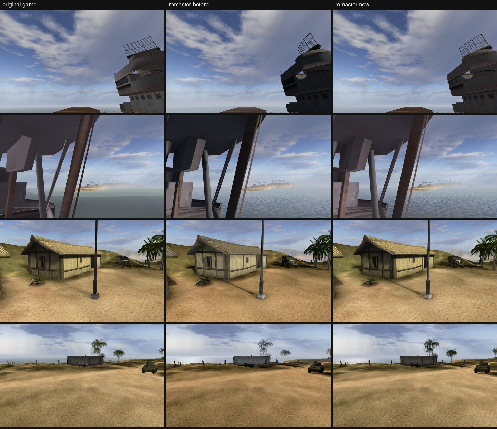

Far palms and a bunker at 200 m (grey ghosts, the hill washed out, and the
sea drawn over the palms' trunks at the right edge), the village across the
lagoon at 300 m, and a palm against the sun:
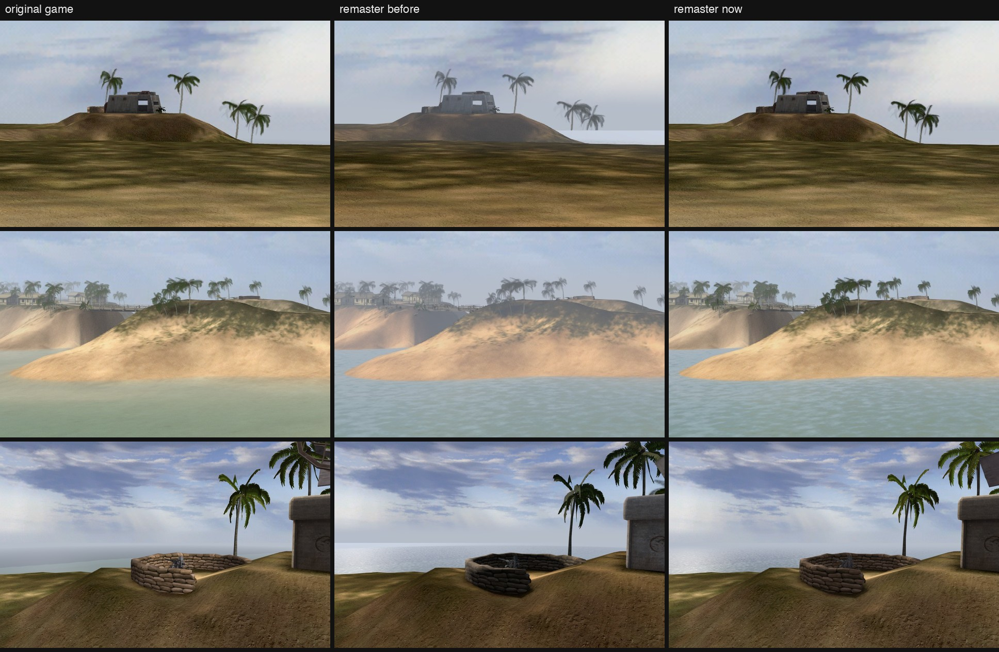

On foot, remaster only: [Wake](shots/wake_on_foot_remaster.jpg),
[Battle of Britain](shots/bob_on_foot_remaster.jpg). Full-size frames:
[Wake](shots/wake_airfield_remaster_full.jpg),
[Battle of Britain](shots/bob_base_remaster_full.jpg).

## Frame time on this M5 Max

1600 x 900, device pixel ratio 1, no bots, median of 60 frames, CPU and GPU
together (`tests/perf/remastershot.mjs`), the machine otherwise quiet. The
retail column is the default path on this branch, unchanged by it.

| Level | View | Retail | Remaster | Remaster CPU |
|---|---|---|---|---|
| Wake | airfield | 5.8 ms | 13.9 ms | 9.0 ms |
| Wake | beach | 5.2 ms | 12.0 ms | 7.5 ms |
| Wake | hill (aerial) | 4.7 ms | 9.9 ms | 6.1 ms |
| Wake | bunker | 3.8 ms | 9.6 ms | 6.3 ms |
| Wake | into the sun (the whole island in view) | 6.9 ms | 18.7 ms | 11.9 ms |
| Battle of Britain | base | 4.7 ms | 11.0 ms | 7.0 ms |
| Battle of Britain | approach | 5.4 ms | 13.9 ms | 8.5 ms |
| Battle of Britain | airfield | 4.0 ms | 9.6 ms | 6.0 ms |
| Battle of Britain | overview | 4.8 ms | 10.4 ms | 6.4 ms |

Every view is inside a 60 fps frame. The table is from 2026-11-12, with the
machine quiet; the changes since did not move it (old and new builds served
side by side and timed back to back on 2026-11-13, with the machine busy:
17.3, 15.4, 11.1, 12.7 and 20.2 ms before, 16.4, 15.4, 13.2, 12.3 and 19.8 ms
after, the five Wake views in the table's order).

Where it goes, measured on 2026-11-13 with the machine busy (Wake airfield,
bunker, into the sun): the whole post chain is 4.6 to 6.6 ms of a frame
(17.1, 12.7 and 20.4 ms with it, 12.5, 6.6 and 13.8 ms drawing the scene
straight to the canvas). Of that, ambient occlusion and the sun shafts
together are 1 to 2.8 ms; the rest is the HDR scene pass, bloom and SMAA.
The shadows are 3 to 4 ms. What is left over retail is three's WebGPU
renderer's own JS cost per draw over r169's WebGL one. None of it is
GPU-bound.

How the shadows got here from 140 ms:

1. The harness had been timing the page's animation loop, not its own
   frames, until three's node frame was advanced per draw (below). The real
   starting point was 24 to 26 ms at a 70 m reach.
2. **Shadow proxies** (`remaster-shadow-proxies.js`): at load every static
   caster (buildings, walls, props, trunks, branch cards and leaf sprites,
   and parked vehicles) is merged into one mesh per 128 m tile and texture,
   drawn only by the sun's shadow cameras (layer 1), and the originals stop
   casting. Wake's ~4,000 caster meshes become ~160 proxies (820k
   triangles); leaf cards are baked facing the sun, which is the face that
   shadows. A vehicle part is watched: once it moves or hides (driven,
   turned, wrecked) it leaves its proxy and casts for itself, and a vehicle
   that shows and stands still joins one. A rebuilt tile is a few
   milliseconds, one tile a second at most.
3. The cascades are staggered: the near one every frame, the middle one
   every second frame, the far one every fourth. A skipped map keeps the
   matrix it was drawn with, so its shadows do not swim.
4. One remaster material per source material, not per mesh: a level's few
   hundred glTF materials had become thousands, each with its own bindings.

## How it is built

The page imports `'three'` everywhere. `map.html`'s static import map names the
vendored r169 WebGL build, as it always has (the image's
`mesh/stamp-viewer.mjs` rewrites it). With the remaster on, a classic script
ahead of it inserts a map of its own naming three r186's `three.webgpu.js`
(`viewer/vendor/three-webgpu/`, copied from `ui/node_modules/three` 0.186.1,
MIT, with the addons used: GTAO, bloom, SMAA, CSM, SkyMesh, radial blur);
where import maps merge, the first definition of `three` wins.
`three.webgpu.js` re-exports the whole core, so every module runs unchanged
on it.

The remaster modules resolve `three/webgpu` and `three/tsl`, which only the
remaster import map names, so the page loads them with dynamic `import()`
and the rest of the page reaches them through one registry, `remasterHooks`,
which is empty without the remaster. It lives on the global
(`globalThis.bfRemasterHooks`), so the retail modules that call into it need
no new import and stay loadable by the test harnesses that copy a module and
its listed neighbours into a temporary folder.

| File | What it does |
|---|---|
| `remaster-mode.js` | the setting (OPTIONS > VIDEO's row, the address for one page) and the hook registry |
| `remaster-renderer.js` | the WebGPU renderer, its WebGL shims, the custom tone curve, shadow casters, the frame and its post chain, flash lights, sun shafts, side renderers |
| `remaster-sky.js` | the painted sky in HDR, the image-based light the water reflects, the fog, the sun and its cascaded shadows, the retail cloud layer |
| `remaster-materials.js` | `EngineMaterial` and its lighting model (the engine's combines with the sun's shadow in them), the first-person rig's material, the proving ground's floor |
| `remaster-shadow-proxies.js` | the merged static shadow casters |
| `remaster-water.js` | the water |
| `remaster-foliage.js` | leaf sprites, billboards, wind |

The retail modules call in where they build their own look:
`level-shading.js` (terrain detail, lightmaps, dynamic shading),
`level-sky.js` (the painted sky, the cloud layer, the water), `tree-foliage.js`,
`effects.js` (glow, flash lights), `gun-groups.js`, `arms-rig.js`,
`hand-weapon.js` and `replay-viewmodel.js` (the first-person rig, drawn
by the engine's combine: `viewMaterial`),
`level-load.js` (the level's atmosphere once it is up), `proving-ground.js`,
`glb-loader.js` (each texture's store hash), the seven side views that build
their own renderer, `level-warmup.js` (its warm points hand their roots to
the remaster's warm-up, below) and `texture-quality.js` (skipped under
WebGPU).

### What each level word drives

| `scene.json` | Retail | Remaster |
|---|---|---|
| `sunDirection` | the vehicles' N.L (and the bake) | the sun: its shadows, the N.L of the vehicles' combine, the water's glint |
| `lighting.diffuse` | the sun's colour and the 2x combine | the same, in the same combine (the real light's tint and strength reach only the water) |
| `lighting.ambient` + `globalAmbient` | the floor of the combine | the same floor, which is also what a cast shadow leaves |
| `lighting.shadowColor` | not read | what the ground keeps of its art in a cast shadow |
| `sky` (the SkyBox mesh), `skybox` (six faces) | drawn unlit | drawn lifted into HDR; reflected by the water |
| `sky.clouds` | the GLSL cloud layer | the same layer as a node material |
| `fogColor` | the fog and the background | the fog's colour |
| `fogStart` | where three's fog ramp starts | the same |
| `fogEnd` | where the world is wholly fogged | the same; the shadows' reach |
| `water` (layers, normal map, scroll, shallow/deep colours, `colorDepth`, depth bake) | the GLSL water | the node water: same textures and scroll, PBR reflection, absorption by the bake |
| lightmaps | `2 * lightmap * texture`, unlit | the same; a sun-facing texel in a real-time shadow is taken down to the bake's own shadow tone |
| terrain tile and detail | `tile + detail - 0.5`, unlit | the same, times `shadowColor` in a cast shadow |

### The pieces

**Shadows.** `CSMShadowNode`, three cascades out to the level's `fogEnd`,
practical splits, 2048 maps, faded edges, refit whenever the camera's
projection changes (CSM fits them once at init). Static casters through the
proxies above; moving ones (vehicles in use, soldiers, flags) cast for
themselves within 450 m. Terrain does not cast (its art has the relief's
shadows painted in), nor its copies past the world's edge, nor far tree
billboards. Cut-outs cast through their map's alpha.

**Sky.** The level's own painted SkyBox (or its cube of six faces), drawn at
its painted brightness through the exposure and tone curve, down to its own
painted horizon, and rendered once into the image-based light the water
reflects. A level with neither (none of the 227 extracted levels) draws its
fog colour, as retail does.

**Surfaces.** One material class, `EngineMaterial`
(`remaster-materials.js`), whose lighting model is the engine's combine for
the kind of surface, in display space, with one number from the renderer in
it: `k`, the sun's N.L against the real sun times the cascaded shadow.

| Kind | Combine | What `k` does |
|---|---|---|
| vehicles, soldiers, bare statics, trunks | `2 * tex * clamp(floor + sun * materialDiffuse * k)`, then `envmap true`'s stage | a face in shadow or turned from the sun draws at the floor, where the engine put its shaded side |
| fronds (a tree's branch cards) | the same | `k` is taken from either side of the card and never under 0.6 of the sun: a frond passes light |
| lightmapped statics | `2 * tex * lightmap` | a sun-facing texel in shadow is taken down to 0.12, where the bake's own cast shadows sit (Wake's read 0.06 to 0.12) |
| terrain | the tile art and detail, unlit | level ground in a cast shadow keeps `lighting.shadowColor` of its art; a slope turned from the sun takes no cast shadow (the ground casts none, so one would fall through the hill) |
| leaf sprites | `2 * tex`, unlit | shaded to 0.66 by the shadow and the canopy's turn |
| far tree cards | the strip, unlit | the same; its alpha is firmed for linear blending |

`floor` is `ambient + globalAmbient`, `sun` is `lighting.diffuse`. Three
hands a lighting model each light's colour with its shadow multiplied in, so
`k` is the sun's term over the light's own colour, and a flash light or an
explosion's adds to it. The sky's image-based light and the hemisphere are
not read by these surfaces. The result is handed the exposure to undo, so it
reaches the screen as the combine left it. The first-person arms and weapon
use the same combine with the retail page's light direction and no shadow
(`viewMaterial`).

**Fog.** The level's own, as the retail page draws it: three's fog between
`fogStart` and `fogEnd` (a smoothstep of the view depth) in `fogColor`,
mixed in display space as the retail page's is and the engine's was. What is
brighter than white (a flame's glow) is carried past the mix.

**Water.** Drawn before every other transparent thing, as the retail water
is. The level's two colour layers and normal map scrolled as retail
scrolls them, a finer procedural ripple, PBR reflection a little over water's
2 %, the bed seen through Beer-Lambert absorption over the baked depth and the
slant of the view, foam on the last third of a metre at the shore.

**Foliage.** Leaf sprites rebuilt around their centres from the drawing
camera's axes in the mesh's own space, so in the sun's shadow pass (which
reads `positionNode`, not `vertexNode`) they face the sun. Leaves and branch
cards are cut at 0.4 instead of blended, so they write depth for the occlusion
pass. A slow gusting sway grows with height; each leaf flutters on its own
phase. The far billboard is the same two-frame azimuth blend, unlit as retail
draws it. The swap between a tree and its card is judged from the player's
camera only (the renderer also calls the hook for each shadow cascade).

**The frame.** A one-sample scene pass (the occlusion reads its depth), GTAO
at half resolution masked off the sky, bloom over 2.4 in HDR, sun shafts (the
bright open sky radially blurred toward the sun's place on the screen), SMAA,
drawn as one full-screen quad through the renderer's own tone-mapped output,
so the overlay passes that follow (the first-person arms, a replay's first
person and spotlight, the proving ground's inset) land on the world and are
tone-mapped with it. The tone curve is Khronos PBR Neutral's highlight
shoulder without its black-level offset, at exposure 0.58. Additive effects
(flames, flashes, tracers) are drawn three times brighter than their texture,
so their cores bloom, and an explosion, a muzzle flash or a fire lights its
surroundings through a pool of four point lights.

## Bugs found on the way

- **The arms smeared over a black world the moment a player spawned.** A
  `RenderPipeline` writes the frame straight to the canvas with tone mapping
  off; the arms pass then drew, with `autoClear` off, into the renderer's own
  tone-mapping framebuffer (which the world never reached and nothing
  cleared) and copied it over the canvas. The frame is now a full-screen quad
  through that same output path (see "The frame"). Found by the owner on
  first play.
- **three r186 shares one compiled node graph between materials whose graphs
  have the same shape**, and with it the texture a `texture(t)` node was
  built with: every terrain patch drew the first patch's tile, every
  lightmapped static the first lightmap. Every texture in a remaster graph is
  read through `materialReference` (`remaster-materials.js` `matTexture`); a
  shadow cut through a reference bound to its own material, because in the
  shadow pass the material being drawn is the depth material; `Material.clone`
  of a remaster material carries its graphs and texture slots.
- **`Skeleton.computeBoneTexture` padded the flag cloths' bone matrices** from
  20 to 36 (WebGL's square bone texture), and WebGPU's 20-matrix uniform
  buffer took 36 every frame (~70 validation errors a second). It is a no-op
  under WebGPU, and a padded array is trimmed.
- **Khronos PBR Neutral's black-level offset** subtracts up to 0.04, taken from
  the smallest channel, from all three, which crushed the low blue of
  BF1942's warm dark art: Wake's ochre field drew orange (96/71/19 against the
  art's 108/89/54). The remaster's own curve keeps the shoulder and drops the
  offset.
- **three's node frame only advances inside `setAnimationLoop`.** A frame
  drawn outside it (`__renderOnce`, a replay's scrub) re-used the last
  frame's passes and shadow maps. `remaster.render()` advances it when the
  loop has not.
- **`compileAsync` with cascaded shadows** sizes their uniform buffers before
  the cascades exist and fails every pipeline it builds. So retail's warm-up
  is skipped under WebGPU, and for a while nothing took its place: every
  building's pipeline was built, and every texture uploaded, by the first
  frame to see it. The owner felt it ("a little stuttery at the start"); a
  camera turning on Wake took 141 to 501 ms frames. The remaster now warms
  its own (`warmPipelines` in `remaster-renderer.js`): five frames after the
  level is up (the cascades exist by then), the whole scene is compiled off
  the main thread against the scene pass's own target, with frustum culling
  lifted for the one synchronous walk. Every texture a material binds is
  then uploaded, 4 ms of it a frame. It runs again three seconds later for
  what the level spawns, and on the first-person overlay when it is built.
  The same turn now peaks at 26 to 83 ms; the build takes about 2.6 s in the
  background on Wake.
- **The first-person weapon was lit by the remaster's sun, and should not
  have been.** The arms and the gun were physically based surfaces under the
  world's sun and sky, like a vehicle. Facing the sun, every face the player
  looks at is in shade and drew by the sky's blue light alone: grey hands,
  flat dark steel. With the sun behind, the same faces took the whole sun
  and washed out (the BAR's receiver on Wake at two to three times the
  retail page's brightness). The owner, twice: "the weapons can look very
  washed out at the peak of the sun", then of the shaded case, "it makes
  everything look rubbery and low detail. In the retail the gun still
  renders beautifully even when in our sun... technically cool but provides
  nothing" (2026-11-13). The rig now draws with the engine's own combine,
  the one the retail page uses, as a node material
  (`remaster-materials.js` `viewMaterial`): `2 * tex * clamp(ambient +
  globalAmbient + diffuse * materialDiffuse * N.L)` in display space, then
  `envmap true`'s stage where the level has a cube, with the light aimed as
  the retail page aims it. `arms-rig.js` marks the rig (`firstPerson`) when
  it asks for its shading. Nothing in the world reads the rig's light: it is
  an overlay pass with no shadow to cast or take. Over eight headings on
  Wake the weapon's mean brightness is retail's (60 against 60 of 255).
  A first attempt kept the real sun at a smaller share and cast a ray from
  the eye to shade the weapon indoors; it was dropped, since the complaint
  was the real sun on the weapon at all.
- **The first-person overlay asked for a warm-up on every frame it drew.**
  `lightOverlay` queued one each call, so a `compileAsync` walk of the rig
  ran sixty times a second for as long as the player was on foot. It is
  asked for once per rig now (a weapon change swaps the rig).
- **The first explosion of a session froze the game** ("very laggy at key
  moments, when I shoot something that explodes", the owner, 2026-11-13).
  Three causes, all the same kind: a pipeline built in the frame that first
  needs it, which waits for the GPU process to compile its shaders.
  1. three's WebGPU `compileAsync` skips a hidden node and everything under
     it, where the WebGL `compile` the retail warm-up relies on walks them.
     The effect pool's parked sprites, vehicles not spawned yet and guns'
     flashes were never built. `warmPipelines` now shows hidden nodes for
     its one synchronous walk (collision hulls excepted) and puts them back.
     The first `BombBig_Expl` on Wake: 444 ms down to 43.
  2. `level-warmup.js` returned early under WebGPU, so the page's own warm
     points (the level once its effect pool is built, a rig, a seat's
     cockpit, a replay's models) reached nothing. `warmSubtree` now hands
     its root to the remaster (`remaster.warm`), which builds it for the
     pass that draws it a few frames on.
  3. Some things do not exist until they are needed: an effect's debris and
     its sprite materials are made when it plays, a wreck is loaded when its
     vehicle dies, a tree's blend band is cloned as it crosses a range, and
     no warm-up reaches the shadow passes. No warm-up can build those. So
     once a level is up, a pipeline met inside a frame is built with
     `createRenderPipelineAsync` (three's own path for `compileAsync`) and
     `draw` skips an object whose pipeline is not ready
     (`installAsyncPipelines`): it appears a few frames late, once, and no
     frame waits. Full-screen quads stay synchronous.
  Measured with `tests/perf/remaster_explosions.mjs`, a cold shader cache
  each run (`pipelineSalt`: macOS keeps compiled shaders between runs, which
  made every run after the first read as already fixed): destroying one
  vehicle of each of eight kinds, four more, and fourteen explosion effects,
  the worst frame was 283 to 486 ms before and 36 to 52 ms now.
- **An explosion's glow drew as a hard-edged rectangle**, and debris and
  smoke glowed with it. The glow hook tripled every material an effect
  made, not only the additive ones, so a destroyed gun's flying parts and an
  explosion's smoke were three times their textures. And the engine added
  `texel * alpha` to the frame in display space, where a faint texel adds
  next to nothing, while this frame is linear, where it is a veil: the
  fireball (`e_fire4`, 16 x 16 on a 21 m quad, a tenth alpha at its border)
  showed its whole quad. The hook now takes only what the data blends
  additively, and a particle's quad adds `EOTF(OETF(rgb) * alpha * opacity)`
  times the glow: the engine's own result over black. A flash that is a
  mesh (a muzzle's, a tracer) is as it was.
- **Everything in the world was relit, and looked worse for it.** Statics,
  vehicles, soldiers, trees and the ground were physically based surfaces
  under the sun and the sky's image-based light. A face out of the sun was
  lit by the sky's blue alone, flattened by the tone curve: a palm against
  the sun was a grey cut-out, the Shokaku's masts grey blobs, a bunker a
  flat pale box, a sunlit hull darker and greyer than its paint, a shaded
  hillside brown where its art is green. The owner (2026-11-13): "the dark
  shadows have that gel grey feeling", "overly darkened and grey contrast",
  "ugly and lacking light and detail". The art is painted for the engine's
  combines, so every surface is drawn with its own (`EngineMaterial`, "The
  pieces"), and the remaster's part is the cast shadow inside the combine's
  sun term.
- **A thrown grenade stopped the picture.** The game ran on and could be
  heard; the frame was frozen. `round-launch.js` clones a thrown round out of
  the hand rig, and since the weapon in the hand got its own material the
  clone carried it into the world. The sun's shadow pass draws every caster
  with a depth material, against which the rig material's per-material
  light could not be resolved (`materialReference` read an undefined
  vector), and the frame threw on every draw from the moment the round left
  the hand. A first-person material now carries its world counterpart
  (`remasterWorld`) and `worldMaterials` swaps it as the round is launched.
  `tests/perf/remaster_explosions.mjs` now ends by spawning on foot and
  throwing what the kit throws, and fails on a frame that throws.
- **Far palms were cut at the waterline.** The remaster's branch of
  `setupWater` returned before the line that gives the water
  `renderOrder = -1`. three sorts transparent things by their origin, the
  sea's is the world's corner, and a far tree card writes no depth: the sea
  was drawn after the card and painted over every palm that stood against
  it, leaving the crown above the horizon and the foot on the sand.
- **Far tree cards were grey wisps.** Their alpha blends in linear light
  here and blended in display space in retail, where a half-covered texel of
  a dark frond is a mid tone and not mostly sky. The card's alpha is firmed,
  `1 - (1 - a)^2.2`.
- **The fog was a quarter thick at 150 m**, where retail's is a few percent,
  in a colour up to 1.8 times brighter toward the sun, and it was mixed in
  linear light, where half fog over a dark thing is mostly fog. Then the
  world shut in a wall over the last fifth of `fogEnd`. It is the level's
  own fog now, mixed in display space ("The pieces").
- **A flat band of fog under the sky.** The painted sky was faded to the fog
  colour in its last degrees above the horizon; from the air that was a
  fifth of the frame where retail shows sky. The paint is drawn to its own
  horizon.
- **The tree swap was judged from the sun.** The WebGPU renderer calls
  `scene.onBeforeRender` for every shadow cascade, each with its own
  orthographic camera, in the middle of the main pass; `tree-foliage.js`
  judged every tree's swap again from there, after the frame had picked what
  to draw. The hook now answers the player's camera only.
- **A cloned node material loses its alpha cut.** three r186's
  `NodeMaterial.copy` copies what it can enumerate; `alphaTest` is an
  accessor with an underscored field and is not reached. A palm in its fade
  band, whose materials `tree-foliage.js` clones to fade them, drew its
  fronds as whole white blades. `cloneWithNodes` and `EngineMaterial.copy`
  carry it.
- **The dev server dropped modules.** `serve_viewer.py` listened with
  socketserver's backlog of 5; the page asks for about 600 modules at once,
  and on macOS 27 some of that burst was reset, so the page never booted.
  The backlog is 1024.
- **Seven side views build a `WebGLRenderer`**, which the WebGPU build does not
  have (the tank sight, the controls preview, the proving ground's card, the
  dogfight and tank schools, tank snapshots); under the remaster they get a
  WebGPU renderer with the same shims. The proving ground's floor was a GLSL
  grid built with r169's uniform helpers; it has a node version.
- **Retail's material passes share `userData` between the per-mesh materials
  made from one glTF material**, and `tree-foliage.js` guards on it: only the
  first mesh's branch cards were processed. The remaster hooks run ahead of
  those guards. Whether the retail path loses anything by it was not checked.
- **The sun's side.** On Wake the terrain art is lit from `+sunDirection`
  (the slopes facing the eye from (1000, 108, -1080) along (0.67, -0.12,
  -0.73) are its brightest), while `level-load.js` aims the retail
  DirectionalLight, and `bindDynamicShading` its N.L, at `(-x, y, -z)`: the
  opposite side in plan. The lightmaps agree with the art (on Wake a wall
  facing `+sunDirection` reads 0.31 on average, one facing the other way
  0.15; El Alamein 0.38 and 0.22). The remaster follows the art, so its
  vehicles are lit from the side their shadows fall away from, the opposite
  side to the retail page's. Whether the retail
  vehicles are lit from the wrong side is a question for the retail path
  (ledger DL rows, `features/level-lighting-laws`), not this branch.

## What looks better

- Light has a direction: buildings, towers, girders, palms and vehicles cast
  real shadows out to the fog, and things that move cast moving ones, onto
  the ground, onto walls and onto each other.
- A shadow is the tone the art already uses for shade, so a shaded face and
  a cast shadow keep the whole texture.
- Palms pass light: fronds glow with the sun behind them.
- The water reflects the sky and the sun, shows the sand in the shallows,
  deepens to the level's deep colour, and foams at the shore.
- Explosions and muzzle flashes are light: HDR cores, bloom, a flash of light
  on the ground and walls around them.
- Trees sway, leaves flutter, and leaves cast leaf-shaped shadows.
- Contact shadows under eaves, in doorways and where objects meet the ground.

## What is still different from retail, and why

These are choices, not open faults.

- **Vehicles, soldiers and trees are lit from the other side** than on the
  retail page: from the side the level's art and lightmaps are lit from
  (see "The sun's side"), which is the side their shadows fall away from.
- **The sea is darker from the air** than retail's, which fogs its water on
  a linear ramp of its own; the remaster's water takes the scene's fog.
- **The first-person arms and weapon take no shadow**, and are lit from the
  retail page's side (the owner's call; see the bugs above).
- **A frame costs about twice retail's** (9.6 to 18.7 ms against 3.8 to 6.9
  on this machine).

## What was removed (2026-11-13)

All of it is in the branch's history up to `ba68619ad`, the last commit
that has it.

| What | Why |
|---|---|
| The spatial audio chain (`remaster-audio*.js`, its notes, tests and measurements; `&remasterAudio=1`) | off by default since the first play ("too muffled... like having headphones on"); the audio modules are back to their retail versions |
| The generated relief maps (`remaster_texture_maps.py`, `?remaster=maps`) | off by default since the first play (the Sherman's relief read as hail damage) |
| The height haze (`?remaster=haze`) | replaced by the level's own fog |
| The physical sky (three's SkyMesh) for a level with no sky of its own | no extracted level is without one |
| The parts-off flags (`noao`, `nobloom`, `noshadow`, `nopost`, `syncpipes`, `showk` and the rest) and the tuning words (`exposure`, `cascades`, `shadowFar`, `shadowSize`, `leafReach`, `solidReach`, `glow`, `waterDebug`) | comparison and tuning aids; the values they defaulted to are constants |
| The tab's `sessionStorage` setting and the menu's `?remaster` carry | the row in OPTIONS > VIDEO |
| 69 of three's addon modules under `vendor/three-webgpu/addons/` | never imported; the six kept are CSM (two files), GTAO, bloom, SMAA and the radial blur |

## Files

- `tools/bf1942-models/viewer/remaster-*.js`, `vendor/three-webgpu/`
- `tools/bf1942-models/viewer/video-options.js`, `play/controls-screen.js`
  (the REMASTER row)
- `tools/bf1942-models/tests/test_remaster_mode.py`,
  `tools/bf1942-models/tests/perf/remastershot.mjs`,
  `tools/bf1942-models/tests/perf/remaster_explosions.mjs`
- `features/remaster-browser/shots/` (the composites above)
