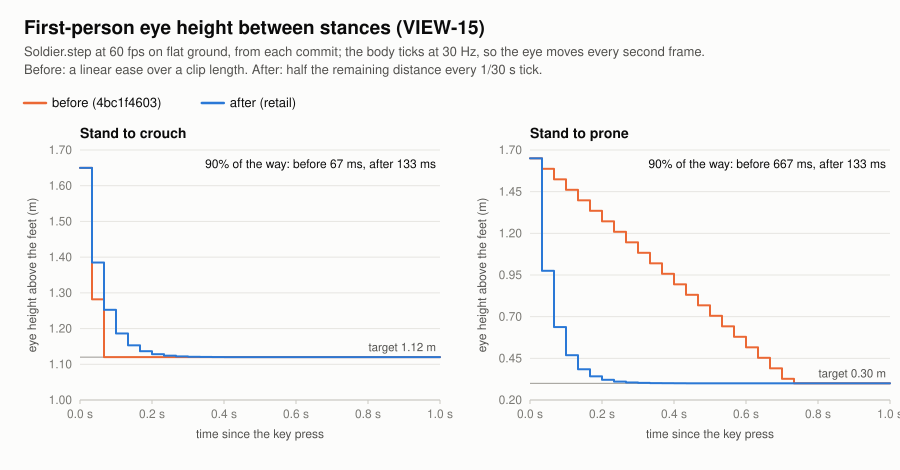
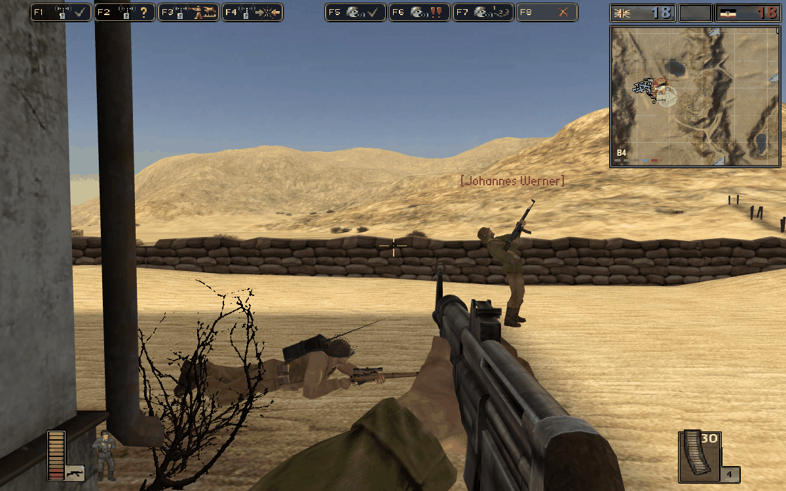
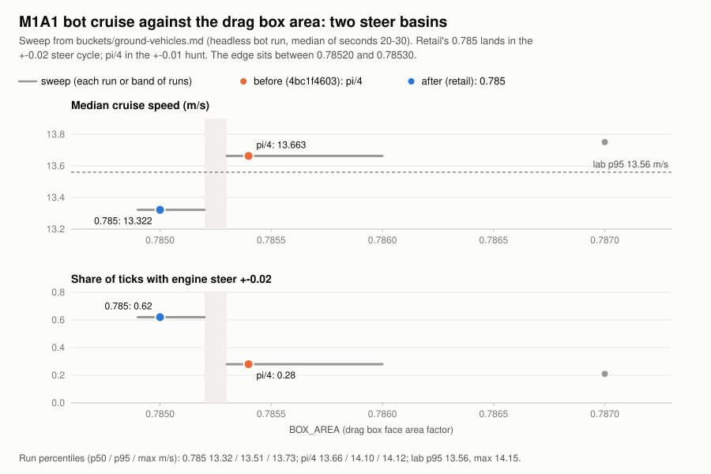
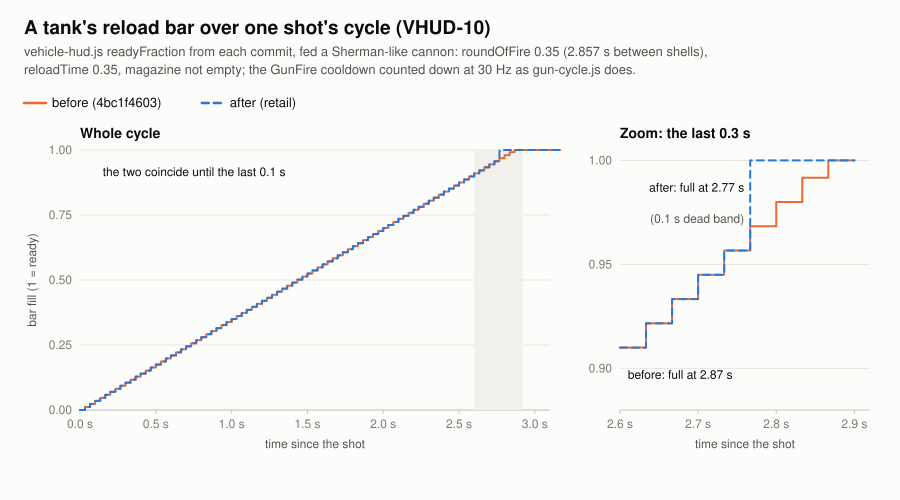
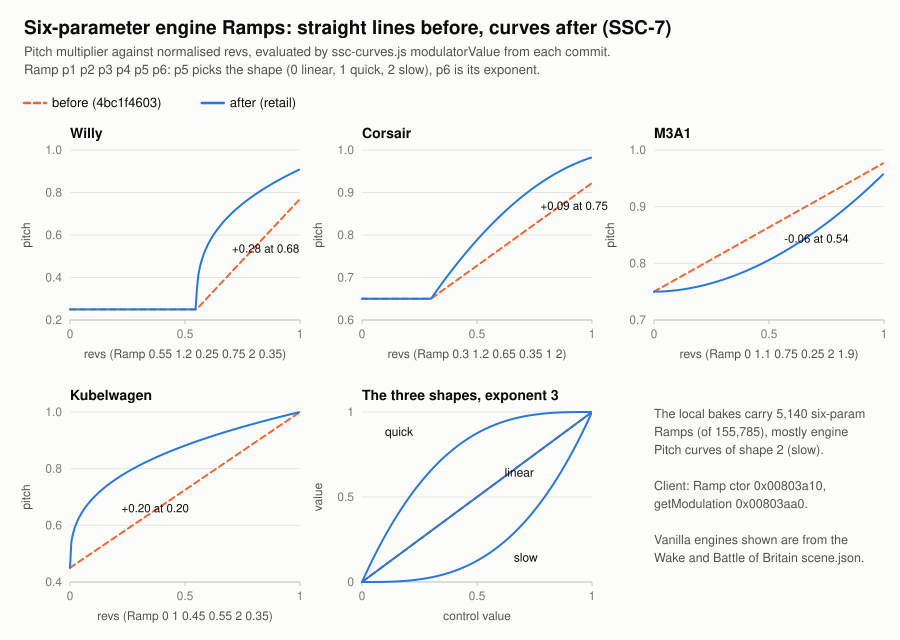
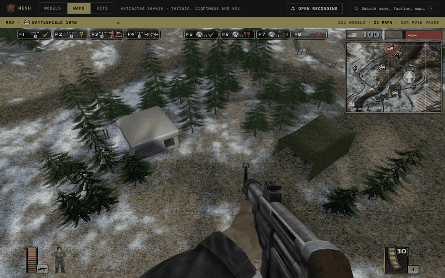
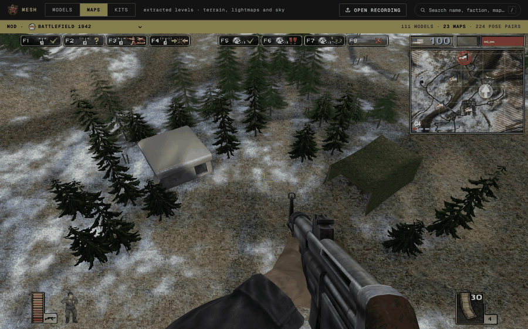
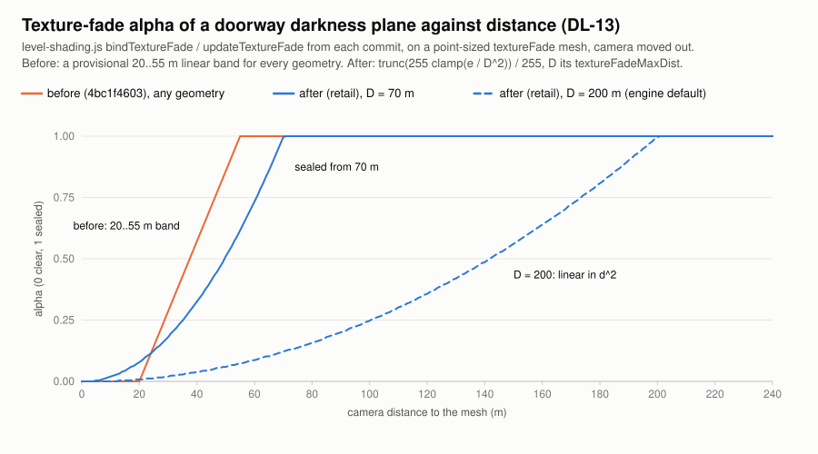
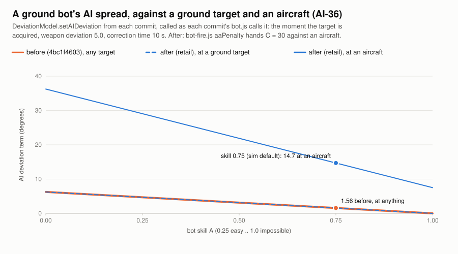
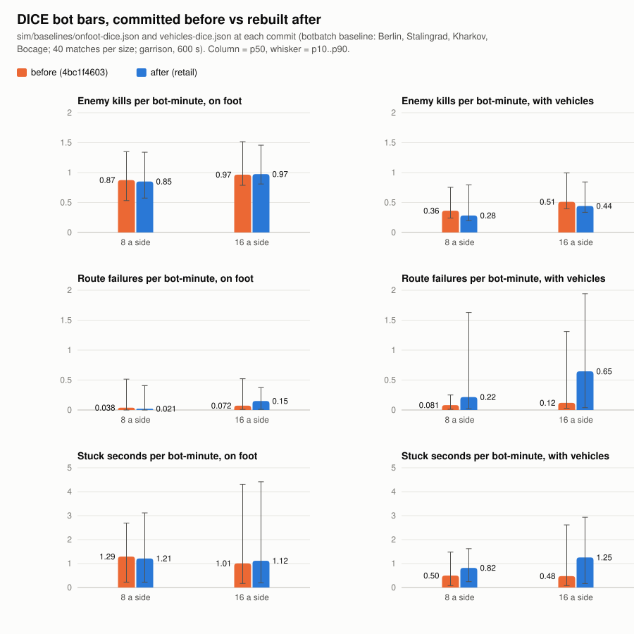

# Retail parity cross-check, 2026-11-12

Status: done 2026-11-12. Every retail citation in the browser game's source was re-checked against a
second, independent decompile and against our own binaries; 70-odd wrong values and laws were fixed,
the ledger was corrected where the decompile and the binary overturned it, and the documented
departures from retail were kept. What is still open is listed at the end.

## How to read this

The browser game (`tools/bf1942-models/viewer/`, `server/`, `sim/`) cites the retail game about
7,900 times in 424 files: 681 distinct client addresses, 1,255 server addresses, about 700 ledger
rows, and prose claims such as "the engine default" or "the server's tick". The files were split
into fifteen buckets by subsystem and each bucket was given to one verifier:

| Bucket | Files | Citations |
|---|---|---|
| soldier physics (body, ground, collision, fall damage) | 23 | 429 |
| soldier states (stance, swim, ladder, parachute, poses) | 24 | 592 |
| hand weapons (deviation, recoil, heat, viewmodel) | 24 | 483 |
| projectiles and effects (flight, impacts, blast, fuses, rockets, bombs) | 25 | 653 |
| damage and armour | 13 | 298 |
| ground vehicles (drivetrain, springs, tracks, hull bodies) | 23 | 833 |
| aircraft and ships (flight, buoyancy, subs, sonar) | 27 | 498 |
| seats and turrets | 21 | 319 |
| cameras and input | 19 | 573 |
| modes, spawns, supply, kits | 38 | 736 |
| HUD, menus, console, radio | 37 | 550 |
| sound | 15 | 213 |
| rendering and level | 35 | 457 |
| bots and AI (with `sim/`) | 50 | 588 |
| netcode, server, replay | 51 | 681 |

Each verifier checked, per citation, that the code matches its ledger row, that the row matches the
third-party decompile (bf1942reverseengineering, read through `recorpus.py`: the WinPC dump is our
`BF1942.exe` address for address, the Linux dump is the 1.61 `.dynamic` server matched by name, the
Mac dump names client-only code), and settled every disagreement on our own `BF1942.exe` and
`bf1942_lnxded.static` with `objdump` and `readmem.py` (added here; `objdump -s` misreads data
addresses in both files). The third-party dump was a lead and a second reader, never the verdict, as
the engine-reference README's "The second corpus" asks. Each bucket's full record, with the MATCH
lists and every address read, is in [`buckets/`](buckets/).

Each finding below gives **what we had** (the file and the old value or rule), **what retail does**
(the address and the instruction or constant that proves it, read on our binary; the third-party
file is named only where it was the lead or was wrong), **what changed** (the new behaviour, the
files and the test that pins it) and the **ledger** row. The verdict tags are: *fixed* (the code was
wrong and now follows retail), *ledger corrected* (the row was wrong), *settled* (an open question
answered, with or without a code change), *kept on purpose* (a documented departure), and *open*.
Code paths are relative to `tools/bf1942-models/`. Where a bucket's later follow-up superseded its
first finding, the entry gives the final state. MATCHes are only counted; the bucket files list
them.

## What a player or bot watcher will notice

- **Bots shoot at aircraft with retail's anti-aircraft spread** (AI-36): a ground shooter firing at
  an air target takes a penalty of 30 (10 from a naval unit, 3 or 1 under a held trigger). Before,
  bots had almost no AI spread against planes.
- **Bots bail out of a tank on a bridge over steep ground** (AI-44): retail compares the hull's up
  with the heightmap normal under it at 0.7071 and never tests aircraft or fixed guns. On Kharkov
  99% of the new flags are tanks level on the two stone bridges over 52-degree banks, so route
  failures on DICE's vehicle levels rose about five-fold. That is the retail rule; to take it back,
  revert the `upright` line in `bot-units.js`.
- **A cone written only in `minDeviation` / `maxDeviation` is point-accurate** (DEV-8): neither word
  is in either binary, so the 78 templates that use only those words keep a zero cone, and the total
  is never clamped. Nothing changes in vanilla: its Bazooka and Panzerschreck carry
  `minDeviation 0.0` and no ordinary deviation words, so their cone was already zero. It matters
  for a mod template with a positive `minDeviation`, which drew a cone the engine never gives.
- **The first-person eye halves its distance each 30 Hz tick** between stances (VIEW-15), instead of
  a linear ease over a clip length.
- **Engine sounds follow their curves** (SSC-7): 5,140 six-parameter `Ramp`s, mostly rev-to-pitch,
  are quick or slow curves with an exponent, not lines. Doppler shifts only looping samples
  (SND-45); the dive angle is `(2/pi) asin` of the nose's descent (SND-24).
- **A soldier's acceleration is clamped** at 1000 m/s^2 a tick (PHY-34): a close satchel or shell
  throws at most 33.3 m/s a tick. A swimmer is pushed by 0.75 + 5.0 times the command. The drowning
  clock also runs while water stands over the origin (HP-23).
- **Engines clip throttle and steer to their own min..max span** (TANK-12): 347 of 1,428 land
  engines are uneven; EoD's trucks reverse at 0.6 of forward. Omitted engine words take the
  constructor's values (differential 10, torque 60, noPropellerEffectAtSpeed 100); twelve bf1918
  engines had faded their thrust at 70 m/s.
- **Damage**: a damage-table pair with no cell does no damage (DMG-1); an unwritten upside-down or
  water rate is 1.0 HP/s; water damage bills from the first wet frame; a ship destroyed in one blow
  stays afloat (HP-13).
- **Capture and spawn**: a lone attacker takes an owned point whose lose timer is spent (AI-100);
  spawn points outside the combat area are never offered (SPAWN-5); the capture radius default is 10
  m; the spawn countdown is the server's wave law at 20 s / 3 s / 5 s (SPAWN-35); a CTF flag with no
  `TimeToReSpawn` goes home at once (CTF-12); depots fire strictly after 0.5 s from a random phase
  (SUP-4).
- **Netcode**: the per-connection budget is 1400 bytes (J-1); the choke is retail's one-pass fair
  share, off by default (R-1); the room client draws remotes 100 ms behind from a 16-snapshot
  history with up to 1.2 s of extrapolation (P-6); the room server runs one tick when more than nine
  are owed (D-4).
- **HUD**: vehicle reload bars are retail's reload-else-fire-interval with a 0.1 s dead band, live
  and in the replay (VHUD-10); the map hides hulls past the view distance outside a joined game
  (MMAP-3); radio items are not dimmed in a joined or hosted Conquest game (RADIO-15).
- **Rendering**: tree billboards swap on horizontal distance times the view's field of view (VID-1);
  the texture fade is linear in selectLod's `e` out to each geometry's `textureFadeMaxDist`, default
  200 m (DL-13).
- **Third-person torso** (ANIM-23): the drawn upper-body bend stops at +-20 aim degrees standing or
  crouched, and lying bends up only, 0..6.

And many smaller ones: strict comparisons where the code had `<=` (the swim exit, the chute close,
the soldier handler's 0.1, the crossfade's 1000, the depot's 0.5), `trunc` and `ceil` where the code
rounded (sense rays, the Aimer's halvings, WPMoveTo, the mounted Fire score), 3.14 x 0.25 for the
box-drag area, parachute clips of 2.0 / 1.0 s, the entry radius default 3.0, a seat's exit at its
own origin, and DEFINE KEY's Grave unbinding the box as Escape does.

## Findings by subsystem

One section per bucket, in the order of the table above.

## Soldier physics

### The walking body's step had no 1000 m/s^2 clamp
Verdict: fixed
- **What we had:** `viewer/walking-body.js` `#updateNode` integrated the summed accumulator
  unclamped, so a blast banked through `_blastDv / dt` threw the soldier at its full value. The
  vehicle twin (`rigid-body.js`) had the clamp.
- **What retail does:** the only positional step, `PhysicsNode::updatePositionalPhysics`
  `0x08253570`, loads 1e6 (`0x082536a1 flds 0x86d1388`), takes `fsqrt` and scales to 1000.0
  (`0x086b1ca8`) when `|acc|^2 > 1e6`, and drops the friction adder whole above 62500
  (`0x082536f5`). A crouched grenade is 600 m/s^2 (KNOCK-6), so a satchel, bomb or close shell about
  1.7 times stronger is cut.
- **What changed:** `#updateNode` imports `ACCEL_CLAMP_LIMIT_SQ`, `ACCEL_CLAMP_SPEED` and
  `POSITIONAL_FRICTION_ZERO_SQ` from `rigid-body.js` and applies them; `tests/test_physics.py`
  `test_one_tick_of_a_huge_push_is_held_to_1000_m_s2` (33.33 m/s). The two-blasts case in
  `tests/test_knockback_seams.py` now adds then clamps (17.15 m/s, not 20.58). The lab move and jump
  laws still match to the mm.
- **Ledger:** PHY-34 item (2).

### A swimmer got 5.0 times the command, not 5.75
Verdict: fixed
- **What we had:** `walking-body.js`'s swim branch added `5.0 * cmd` (x and z only) and skipped the
  0.75 locomotion force; `swim.js` said the 0.75 was gated off for swimmers.
- **What retail does:** in `BFSoldier::handlePlayerInput` only the jump branch (`0x082749e3`)
  bypasses the 0.75 block (`0x08274a09 flds 0x86ba8cc`); the swim block follows it (`0x08274b5f`
  swim flag, `0x08274b6f` 5.0) and multiplies all three command rows.
- **What changed:** the swim push is `(5.0 + 0.75) * (cmdX, cmdY, cmdZ)`; `swim.js`'s
  `SWIM_ACCEL_GAIN` doc says so. `SWIM_SPEED_CEILING_FACTOR` was not retuned and "a swimmer is
  slower than a runner" still passes.
- **Ledger:** PHY-34 item (1), PHY-6.

### `body-friction.js` had a dead soldier arm on the vehicle law
Verdict: fixed
- **What we had:** `viewer/body-friction.js` gave a `'soldier'` response a zero normal ("written by
  nothing") and the vehicle `1.5 * 9.82` budget. No caller passes `'soldier'`; the walking body runs
  its own law.
- **What retail does:** `BFSoldier::handleCollision` writes the normal to `+0x98` (`0x0827d52f`);
  `addFriction` uses 4.8 / 7.2 (`0x0825c5e0`, `0x0825c5ee`) times `Ny^5`.
- **What changed:** the arm is deleted; a `'soldier'` response throws and points to `walking-body.js
  #contactLaw`, and the comment states the real law.
- **Ledger:** PHY-2, PHY-2b.

### The box-drag face area was pi/4, not 3.14 x 0.25
Verdict: fixed
- **What we had:** `viewer/ground-contact.js` `BOX_AREA = Math.PI / 4`.
- **What retail does:** lnxded `0x082545b8 flds 0x86d1384` = 3.14 times 0.25; the client folds it to
  `0x008f733c` = 0.7850000262 (`fmuls` at `0x00540be7`).
- **What changed:** `BOX_AREA = Math.fround(Math.fround(3.14) * 0.25)`, bit-equal to the client;
  `tests/test_ground.py` `test_a_hull_drags_by_the_box_law` now expects 0.785f. The same constant
  runs in the ship and amphibious laws (aircraft and ships below). It also
  moved the bot M1A1's cruise into another steering basin (ground vehicles, below).
- **Ledger:** PHY-22.

### The soldier handler gate is strictly over 0.1
Verdict: ledger corrected
- **What we had:** PHY-34 (3) said `|v|^2 >= 0.1`; `walking-body.js` used `>=`.
- **What retail does:** `ResponsePhysics::checkVsTerrain` `0x0825af9d` loads 0.1 and `0x0825afac
  fucompp; jne` skips the handler at `<= 0.1`.
- **What changed:** `#contactLaw` uses `>`; no behaviour change in practice.
- **Ledger:** PHY-34 item (3).

### Swimming and the parachute step the old point body
Verdict: kept on purpose
- **What we had:** `walking-body.js` steps a swimmer and a canopy on the `PointPhysicsNode` (four
  sub-steps, sphere drag) with a tuned ceiling.
- **What retail does:** both are on the soldier's `PhysicsNode` box law.
- **What changed:** nothing; documented in PHY-34's "not covered" list. Retune
  `SWIM_SPEED_CEILING_FACTOR` with the 5.75 push in mind.
- **Ledger:** PHY-34.

### Catch-up caps of 12 and 10 ticks
Verdict: kept on purpose
- **What we had:** `fixed-step.js` `MAX_CATCH_UP_TICKS = 12`; `body-world.js` `MAX_BACKLOG_TICKS =
  10`, commented as "the engine's own rule".
- **What retail does:** the server collapses more than nine owed ticks to one (`0x08132955 cmpl
  $0x9`); the client does the same at `0x0048fca8`, after `InputManager`'s more-than-ten rule.
- **What changed:** the `body-world.js` comment now names both retail rules and calls 10 the page's
  choice. The room server does the retail thing (netcode, below).
- **Ledger:** LOOP-1.

### `LOW_SNAP_SHARE_B = -1` and the dead soldier's collision offset
Verdict: kept on purpose
- **What we had:** `body-contact.js` uses -1 where the binary stores the residual stack value
  (`0x0825a3d5`), and `walking-body.js` does not model the dead soldier's `setCollisionOffset` arm
  (`0x08273512`).
- **What changed:** nothing; both are documented (collision-response.md sections 6.1 and 12;
  PHY-38).
- **Ledger:** PHY-38.

### The soldier's drag bounding radius, 0.8
Verdict: open
- **What we had:** `point-body.js` `SOLDIER_BOUNDING_RADIUS = 0.8`, "inferred".
- **What retail does:** `PointPhysicsNode::getBoundingRadius` `0x08256510` returns the owner's
  vt+0x48, for a soldier `BCompositeObject<IPlayerObject>::getBoundingRadius` `0x08165630`: a cached
  runtime radius of the soldier's geometry plus every kit child. No constant.
- **What changed:** nothing. It feeds only the swim and parachute body, whose tuning rests on 0.8.
  To settle: a lab read of `0x08165630` on a live soldier.
- **Ledger:** PARA-6 (note appended).

31 citation groups matched.

## Soldier states

### The drowning clock armed only while swimming
Verdict: fixed
- **What we had:** `viewer/soldier.js` fed `swim.swimming` to the drown timer; `swim.js` said wading
  never starts the clock.
- **What retail does:** `Armor::update` sets the wet byte `+0x10` from two writers: the swim latch,
  and its own test `water > pos.y - deepWaterLevel` (`0x08172faa`..`0x08172fc8`, `deepWaterLevel` 0
  from the constructor `0x08172354`). The water timer reads that byte (`0x08173150`). A soldier
  whose origin (a metre over the feet) is under water is wet: 1.0 to 1.43 m of wading before the
  swim state, and the 0 to 0.35 m band walking out.
- **What changed:** `soldier.js` feeds `swim.swimming || swim.depth > 0`; `swim.js`'s paragraph
  names both writers.
- **Ledger:** HP-23 (new).

### The swimmer's force
Verdict: fixed
- Same finding as soldier physics' 0.75 + 5.0; the force is applied in `walking-body.js`, the doc in
  `swim.js`. Ledger: PHY-6, PHY-34.

### The swim exit and the chute close are strict
Verdict: fixed
- **What we had:** `swim.js` left the water at `depth <= 0.35`; `parachute.js` closed the canopy at
  `|vy| <= 2.0`; PARA-5 and PARA-6 said `<=`.
- **What retail does:** `updateSwimming` `0x082822ba je` to `Lb_EndSwim` only when 0.35 > depth (at
  exactly 0.35 the swimmer stays and is pinned); `handleUpdate` `0x08272f30 jne` skips
  `setIsParachuting(0)` unless 2.0 > `|vy|` (double 2.0 at `0x086c0330`). The Linux dump's
  `updateSwimming.c:94` agrees.
- **What changed:** `<` in both; `tests/test_swim.py` `test_the_exit_is_strict`.
- **Ledger:** PHY-44 (new), PARA-5, PARA-6 (both corrected).

### The first-person eye halves its distance each tick
Verdict: fixed
- **What we had:** `soldier.js` `STANCE_TRANSITION`, a table of clip lengths from a refuted 26 fps
  frame law, drove a linear ease in `walking-body.js`; the running dive lowered the eye over 0.714
  s.
- **What retail does:** client `BFSoldier::handleUpdate` picks the pose's `setPoseCameraPos`
  (`0x004fd425`), pushes 0.5 (`0x004fd42c`) and lerps (`0x004fd441`) every simulation tick; lnxded
  twin `0x082721dd`..`0x08272269`. A dive has the eye 87% of the way down in three ticks.
- **What changed:** `walking-body.js` does `eyeHeight += (target - eyeHeight) * (1 - 0.5^(dt *
  30))`; `STANCE_TRANSITION` is gone. `tests/test_soldier.py`
  `test_the_eye_halves_its_distance_every_engine_tick` replaces the test that asserted the 26 fps
  table.
- **Ledger:** VIEW-15.

### Parachute clip lengths used the refuted frame law
Verdict: fixed
- **What we had:** `parachute.js` `OPEN_CLIP_SECONDS = 41 / (26 * 0.5)` (3.154 s) and
  `LANDED_CLIP_SECONDS = 6 / 26`.
- **What retail does:** `updateState` advances phase by `dt * speed` (`0x0832b4fa`..`0x0832b509`),
  no frame count; the clips' `addAnimation` speeds are 0.5 and 1, so the passes last 2.0 s and 1.0
  s.
- **What changed:** 2.0 s and 1.0 s; `features/viewer-parachute/README.md` updated;
  `tests/test_parachute.py` `test_the_one_shot_clips_last_one_over_their_speed`.
- **Ledger:** ANIM-2, ANIM-6.

### The drawn upper-body pitch clamp
Verdict: fixed
- **What we had:** `soldier.js` declared `LIE_POINT_UP_DOWN_DEG` and never read it; `replay-gait.js`
  drew no bend lying down and clamped standing at +-60 drawn degrees.
- **What retail does:** `setLiePointUpDownAngle` (`0x082bb420`) writes template `+0x194` / `+0x198`;
  `BFSoldier::updateAnimations` clamps the drawn pitch into [-6, 0] while lying (`0x0826f109`,
  `0x0826f122`), else into [-20, 20] (`0x086d26f0`, `0x086c0314`), then `setRotateXDeg`. The aim
  register's own clamp reads only `setPointUpDownAngle` (`0x082744ff`), so it is a drawing clamp,
  not a look limit.
- **What changed:** `remote-gait.js` `drawnAimPitch`, used by `replay-gait.js` `bendTorso` (replay
  and bots) and `netcode-render.js` `twistTorso` (remote players); lying soldiers now bend.
  `tests/test_remote_gait.py` `DrawnAimPitchTests`, `tests/test_replay_aim_bend.py`. The vanilla
  pair is used; no extractor carries the word yet.
- **Ledger:** ANIM-23 (new), ANIM-5.

| Before | After |
|---|---|
|  |  |

Two bots aim up. The prone one lies flat before; after, it raises its chest by the lie limit (6 register degrees, 15 drawn). The standing one bends 60 drawn degrees before; after, it stops at 50 (+-20 register). The kits are rolled per page load, so the weapons differ.

### Stand-up refusal under a ceiling
Verdict: kept on purpose
- **What we had:** `soldier.js` refuses to stand into a ceiling (a 0.1 m ray).
- **What retail does:** the stance branch `0x08275540`..`0x08275600` tests only flags; retail stands
  into the ceiling (no movement capsule).
- **What changed:** documented as a departure in `soldier.js` and
  `features/viewer-soldier-stance-and-blast/README.md`.
- **Ledger:** PHY-37.

### Viewer numbers carried knowingly
Verdict: kept on purpose
- `SWIM_SPEED_CEILING_FACTOR` 1/3, `PARACHUTE_DRAG_RADIUS` 1.8, `FREE_FALL_TRACK_SPEED`, the step
  and snap heights 0.45, the 60-degree ground slope, `JUMP_STATE_ENTRY_TICKS`, `SOLDIER_DRAG_AREAS`,
  the ladder reach and touch stand-ins, the soldier capsule, and the terrain-ray slip at
  `0x0815b723` that is named and not reproduced. Each is labelled in its file. Ledger: PARA-6,
  PARA-9, PHY-1.

### Stale comments
Verdict: fixed
- `soldier.js` claimed the eye takes 0.282 s down (the dive is 0.714 s and the eye does not follow
  the clip); `soldier-pose.js` `POSE_TRANSITION` said durations come off the clips. Both rewritten.

About 30 rows and functions matched.

## Hand weapons

### `minDeviation` / `maxDeviation` are words neither binary knows
Verdict: fixed
- **What we had:** `viewer/deviation.js` used `minDeviation` as a cone floor and `maxDeviation` as a
  lid, fed by `bf42/con.py`; its header listed the AT family as open.
- **What retail does:** neither word is in either binary's strings (0 hits, and 0 in the third-party
  corpus). The `FireArmsTemplate` constructor writes 0 to `+0x2ec..+0x304`
  (`0x0828d7de`..`0x0828d7f6`), and `HandFireArms::updateDeviation` stores `fire + minDev + speed +
  turn + misc + AI` with no clamp (`0x08294139`..`0x0829415d`). The 78 templates that use only those
  words, are point-accurate. The vanilla Bazooka and Panzerschreck carry `minDeviation 0.0`, so they draw
  the same as before; a mod template with a positive floor is what changes.
- **What changed:** `floor()` returns `this.data.min ?? 0`; the lid is gone.
  `tests/test_deviation.py` `test_the_at_words_floor_and_lid_nothing` (the cone reaches the speed
  channel's own cap, 2.0). `con.py` still exports the keys.
- **Ledger:** DEV-8.

### The viewmodel crossfade snaps only above 1000
Verdict: fixed
- **What we had:** `viewer/arms-rig.js` cut at `factor >= 1000`.
- **What retail does:** `0x0832b481` compares with 1000.0 (`0x086b1ca8`) and blends when the factor
  is at most 1000; the snap at `0x0832b499` runs only above it.
- **What changed:** `>` in `arms-rig.js` and the `viewmodel-anim.js` comment. At most one frame
  differs.
- **Ledger:** none.

### The recoil ride cited the wrong rows and had none of its own
Verdict: ledger corrected
- **What we had:** `recoil.js`, `hand-fire.js` and `world-soldier-tick.js` cited FA-2..FA-5 (the
  projectile pool, velocity default, autoFire, dummies).
- **What retail does:** the draw is FA-22. The ride arms a counter of 20 with `goBackOnRecoil` or 8
  without (`0x0827e53b`..`0x0827e551`) and adds `amount x table[counter] x devMod` into the look
  input each tick (`0x08275c5f`..`0x08275c97`), from `recoilTabel` `0x0872ee20` and `recoilTabel2`
  `0x0872ee80`; each half sums to 0.75.
- **What changed:** the comments cite FA-22 and FA-26; `tests/test_recoil.py` likewise. No behaviour
  changed.
- **Ledger:** FA-26 (new), FA-22.

### The world camera's zoom FOV ease
Verdict: open
- **What we had:** `hand-fire.js` borrows the arms' `0.7 cur + 0.3 target` ease for
  `page.camera.fov`, marked a stand-in.
- **What retail does:** the arms' ease matches (Mac `handleVisualUpdate`). The camera-mode switch at
  `0x004fc8b6` sets the zoom flag only; the vehicle FOV path (`Camera::setVehicleFOV`) snaps. The
  world FOV consumer was not found.
- **What changed:** nothing. To settle: find the client function that reads the held weapon's
  zoomFov and writes the render view's FOV.
- **Ledger:** none.

### Non-uniform recoil distributions
Verdict: settled
- **What we had:** `recoil.js` draws every recoil force uniform, and `con.py` `crd_range` drops the
  distribution kind.
- **What retail does:** `calcRecoil` `0x0827e2f0` handles NONE, UNIFORM, EXPONENTIAL and NORMAL and
  a mirror byte. A survey of every weapon `.con` in all twelve mods found 2,264 `setRecoilForce*`
  lines, all `CRD_UNIFORM` with mirror 0.
- **What changed:** nothing; a future mod using another kind would be drawn wrong silently.
- **Ledger:** FA-26.

24 citation groups matched. The grenade charge branch (GUN-19, GUN-14) is now read in objdump rather
than the decompile alone.

## Projectiles and effects

### A round with no `timeToLive` lives 0 to 3 s, not 10 s
Verdict: fixed
- **What we had:** `viewer/projectile-damage.js` `DEFAULT_TIME_TO_LIVE = 10` (and `||` turned an
  authored 0 into 10); the tracer path fell back to a flat 1.5 s.
- **What retail does:** the `ProjectileTemplate` constructor ends by writing dist 1 (uniform), a =
  3.0, b = 0 (`0x0831fa8c`..`0x0831fab0`); `Projectile::activate` draws it per round (`0x0831e1e7`),
  through `Random::getContinuousRandom` `0x081e28b0`. That is uniform over 0 to 3 s, mean 1.5 s.
- **What changed:** `defaultTimeToLive(rand)` draws `['u', 3, 0, 0]`; `round-launch.js` uses it on
  the shell and tracer `data` paths; `tests/test_effects.py` checks 0..3. A baked 0 still takes the
  draw, because a glb holds only a distribution's first number.
- **Ledger:** PROX-10 (new).

### Passing rounds dropped under 9.81
Verdict: fixed
- **What we had:** `viewer/passing-rounds.js` `GRAVITY = 9.81` for where a round's crack is heard.
- **What retail does:** client `0x00578f11 movl $0xc16bae14` = -14.73.
- **What changed:** imports the shared `GRAVITY` from `point-body.js`. Only rounds with a non-zero
  `gravityModifier` move.
- **Ledger:** IMP-7.

### Rocket and torpedo engines used differential 1 and torque 0
Verdict: fixed
- **What we had:** `viewer/rocket-motor.js` `part.differential ?? 1`, `part.torque ?? 0`;
  `torpedo-run.js` skipped an engine without `differential`.
- **What retail does:** `EngineTemplate::EngineTemplate` stores 10.0 (`0x0823f022`), 60.0
  (`0x0823f02c`) and noPropellerEffectAtSpeed 100.0 (`0x0823f06e`).
- **What changed:** `ROCKET_ENGINE_DEFAULTS` {10, 60, 100} in `rocket-motor.js`; `torpedo-run.js`
  defaults instead of skipping. Latent: all 1,015 baked rocket engines author both words.
- **Ledger:** TANK-7 (the constructor defaults).

### An end-of-life explosion skips nobody
Verdict: settled
- **What we had:** `viewer/round-impact.js` marked the end-of-life record's NULL source armour
  "UNVERIFIED".
- **What retail does:** `handleExplosionOnObject` finds the victim's first `IArmor` (`push 0xc4a4`,
  `0x08156553`) and skips it only when it equals the source argument (`0x08156597 cmpl`, `0x0815659a
  je`); `Projectile::startEndEffect` passes NULL (`0x0831f727`). Your own grenade hurts you; the
  impact path skips only the firer's armour.
- **What changed:** the note is replaced by the read; `firer: -1` was right.
- **Ledger:** HP-9g (new).

### A thrown round's spin is rad/s on a full body; a point body never spins
Verdict: settled
- **What we had:** `viewer/round-launch.js` applied `rotationalSpeed` to every round and called the
  unit unverified.
- **What retail does:** `updateRotationalPhysics` turns by `dt x |w| x 57.2958` degrees
  (`0x08253e42`..`0x08253e63`), so rad/s; `PointPhysicsNode::setRotationalSpeed` `0x082568b0` is
  empty.
- **What changed:** the spin applies only when `hasPointPhysics === false`;
  `tests/test_gunfire_layers.py`. A glb baked before `hasPointPhysics` was recorded loses its
  tumble.
- **Ledger:** COL-8.

### The proximity fuse runs before the round moves
Verdict: fixed
- **What we had:** `viewer/projectile-flight.js` swept for contact, then tested the fuse at the new
  position, and called the order unread.
- **What retail does:** `GameServer::simulateFrame` runs object updates, which hold the fuse
  (`0x0815c2e6`..`0x0815c304`), before the physics nodes move the round (`0x0815c31a`) and before
  world collision (`0x0815c342`).
- **What changed:** `advanceProjectiles` runs the fuse first at the pre-move position;
  `tests/test_proximity_fuse.py` `test_the_fuse_runs_before_the_ticks_move_and_contact`.
- **Ledger:** IMP-8.

### A bomb rack's salvo goes into ammunition debt in retail
Verdict: ledger corrected
- **What we had:** BOMB-5 said the rack "never goes into ammunition debt"; `bomb-release.js` `salvo`
  charges the barrels fired.
- **What retail does:** `fireFinished` charges the full `barrelCount`, unclamped (`0x0828878d
  subl`), so WasserFallGuns (25 barrels, magazine 1) ends at -24, and a 2-barrel rack on its last
  round lands on -1, the unlimited sentinel.
- **What changed:** the row is corrected; the code keeps no debt on purpose (see Kept on purpose).
  `bomb-release.js` says what the engine does.
- **Ledger:** BOMB-5.

### Viewer guards and measured numbers
Verdict: kept on purpose
- The artillery kick measured from a retail clip, the tracer's 2.5 px floor, the 192 casts per
  frame, the streak never longer than the distance flown, the 20 s flight ceiling and range recycle,
  the model browser's tracer slow motion, the 1,200-particle cap, the bomb release by weapon slot,
  and tail-fin weathervaning without round inertia. Each is labelled in its file.

27 groups matched on the binary, and about 40 more citations against their ledger rows.

## Damage and armour

### Unwritten upside-down and water rates are 1.0 HP/s
Verdict: fixed
- **What we had:** `viewer/vehicle-damage.js` set an unauthored `hpLostWhileUpSideDown` /
  `hpLostWhileDamageFromWater` to null, which meant never.
- **What retail does:** the `SimpleObjectTemplate` constructor stores 1.0 to `+0xfc` and `+0x100`
  (`0x081dbe3b`, `0x081dbe41`), which `setArmorComponent` hands to `setHpLostWhileUpSideDown` and
  `setHpLostWhileDamageFromWater` (`0x081ddd2d`..`0x081ddd4a`).
- **What changed:** `armor.js` defaults of 1 used by `DamageableVehicle`. 32 of 73 armoured vanilla
  templates (the Pak40, flak38, MGs, every ship and sub) now lose 1 HP/s upside down; five radar
  towers bill 1 HP/s wet.
- **Ledger:** HP-22.

### Water damage bills from the first wet frame
Verdict: fixed
- **What we had:** `vehicle-damage.js` accumulated whole seconds, so the first bill came 1 s after
  entering water and a short dip cost nothing.
- **What retail does:** `Armor::update` counts `+0xe4` down while wet and bills when it goes below
  0, then reloads 1.0 (`0x081732b8`); dry, it resets to the delay (`0x081732c7`), whose constructor
  default is 0 (`0x081dbdc0`).
- **What changed:** a float `waterTimer` with that law, reading `extras.waterDamageDelay`; the
  extractor now ships the word. `tests/test_vehicle_damage.py`.
- **Ledger:** HP-5.

### A missing damage-table cell does no damage
Verdict: fixed
- **What we had:** `vehicle-hits.js` `botRoundDamage` and `round-impact.js` priced a missing cell at
  x1; the Bayonet did 12 HP to soldiers where retail does 0.
- **What retail does:** `getDamageMod` `0x08175040` falls back to `[ebx+0x24]`, which both
  MaterialManager constructors write 0; the projectile site multiplies it straight in
  (`0x0815416d`). An unknown id retries material 0.
- **What changed:** both paths price through `crash-damage.js` `materialDamage` / `damageModifier`.
  The first cut read our own plumbing gap (a bot round whose weapon glb has not loaded) as material
  0, and bot kills on foot fell from 0.87 to 0.016 a bot-minute (Caught on the way). The engine's
  own rule for an absent material is material 0 (`Projectile::handleCollision` `0x0831eeda`,
  template default -1 at `0x081dbd4c`, contact material 0 at `0x08257540`), so the fix is
  `crash-damage.js` `roundAttackerMaterial`: null for our gap (the 30 HP stand-in, or no direct
  damage on the page's own rounds), 0 for a template that authors none. `sim/level.mjs` shares it.
  `tests/test_round_damage_parity.py`.
- **Ledger:** DMG-1.

### The critical bleed shares one bank with the upside-down bill
Verdict: fixed
- **What we had:** `vehicle-damage.js` kept a separate whole-second `criticalAccumulator` from the
  moment of going critical.
- **What retail does:** one float bank `+0xe8` runs from spawn (`0x08173135`); at 1 or more it bills
  `bank x hpLostWhileCriticalDamage` (`0x08173640`) and then the upside-down rate, and zeroes with
  no carry (`0x0817336d`).
- **What changed:** the single bank in `Armor::update`'s order; totals agree, the phase now matches.
- **Ledger:** HP-17, HP-5.

### A skeleton hit reports the bone, at distance -0.1
Verdict: fixed
- **What we had:** `viewer/skeleton-hit.js` returned the round's closest point on the capsule.
- **What retail does:** `SkeletonCollisionMesh::getDistanceToGeometry` writes the struck bone's
  world position (`0x083af00b flds 0x78`) and a literal -0.1 (`0x083af0d4 movl $0xbdcccccd`).
- **What changed:** `buildCapsules` keeps each bone's origin; `skeletonHit` returns it with
  `SKELETON_HIT_DISTANCE`. `tests/test_skeleton_hit.py`.
- **Ledger:** DIE-10.

### The death effect is keyed by the last hit material
Verdict: fixed
- **What we had:** `vehicle-damage.js` `deathTier` keyed -1 in water, else 0.
- **What retail does:** `Armor::playEffect` `0x08172960` keys 0 with no hit material, `-material`
  out of water, -1 in it; `getEffect` falls back to 0. `SimpleObject::handleCollision` records the
  other side's material (`0x081dae4d`).
- **What changed:** `deathKey` / `tierAt` moved into `vehicle-damage.js`; `crash-damage.js` records
  each contact's material and `world-damage.js` notes water. A hull last touched by the sea that
  dies beached now plays its -1 tier. `tests/test_vehicle_damage.py`
  `test_the_death_tier_reads_the_hulls_own_last_material`.
- **Ledger:** ARM-11.

### `getEffect` takes the smallest threshold at or above
Verdict: ledger corrected
- **What we had:** ARM-1 and `hitpoints-and-damage.md` section 8 said "nearest threshold below".
- **What retail does:** `getEffect` `0x08172820` returns null above the highest key and otherwise
  walks back while `prev.key >= key` (`0x08172890`..`0x081728da`); the key is `ceil(hp)`
  (`0x08172e6d`).
- **What changed:** both texts; `vehicle-damage.js` `activeTier`, already right, loses its OPEN
  note. `soldier-armor-effects.js` cited ARM-8..ARM-10, rows that do not exist; it now cites ARM-1
  and ARM-11.
- **Ledger:** ARM-1.

### Deep-water damage
Verdict: fixed
- **What we had:** not modelled.
- **What retail does:** `Armor::update` sets wet and deep when `water > pos.y - deepWaterLevel`
  (`0x08172f9d`..`0x08172fcc`) and bills `hpLostWhileDamageFromDeepWater` on its own countdown; off
  by default. A census found bf1918 authors `damageFromDeepWater 1` on 137 templates; vanilla, RtR
  and SW author none.
- **What changed:** the runtime in `vehicle-damage.js` / `world-damage.js`, and `bf42/con.py` /
  `bf42/assemble.py` carry the five water words (`tests/test_con.py`). The trees are not
  re-extracted (Data that still has to catch up).
- **Ledger:** HP-5.

### Which of several soldiers on one round's path is met
Verdict: open
- **What we had:** `vehicle-hits.js` `roundBodyCast` keeps the smallest `t`.
- **What retail does:** every skeleton hit reports -0.1, so the order among candidates is decided
  elsewhere; not read.
- **What changed:** nothing. To settle: the candidate loop in `checkObjectVsObjects` `0x0825d820`
  and `PointResponsePhysics::checkObjectVsObject` `0x08257030`.
- **Ledger:** DIE-10.

### A ship destroyed in one blow stays afloat
Verdict: settled
- **What we had:** `hull-bodies.js` and `effect-objects.js` armed a ship's sink rate on `hp <=
  criticalDamage`, which a dead hull passes, so a one-blow kill sank; `body-float.js` marked the
  question unverified.
- **What retail does:** `Armor::status` jumps straight to the death block for a value at or under
  0.001 (`0x08173a06`); that block sends `0x15` (`0x08173d62`) and never reaches `push $0x14`
  (`0x08173ad6`). `FloatingBundle::handleMessage` arms the sink rate only on `0x14` (`0x08240557`).
- **What changed:** `DamageableVehicle.criticalFlagged` models the message byte; both arm sites read
  it. `tests/test_deck_spawn_host.py` `test_a_ship_killed_in_one_blow_never_arms_her_sink_rate`.
  DC's `flagkill` now turns at full rate while it bleeds.
- **Ledger:** HP-13.

### Bot hold-fire
Verdict: kept on purpose
- `friendly-fire.js` holds a bot's fire through a teammate; retail has no such avoidance. Documented
  in `features/bot-friendly-fire`. Ledger: FF-7.

34 groups matched.

## Ground vehicles

### Engine servo rates: the default is 0.1, and a maxSpeed-0 axis has no servo
Verdict: fixed
- **What we had:** `viewer/ground-engine.js` and `tracked-vehicle.js` fell back to `setMaxSpeed`
  when `setAcceleration` was omitted.
- **What retail does:** `RotationalBundleTemplate`'s constructor stores 0.1 to `+0x180..+0x188`
  (`0x081d913c`) and maxSpeed 1.0 (`0x081d912b`); `Engine::handleUpdate` calls
  `calculateAndClipAngle` for an axis only when its maxSpeed is non-zero (`0x0823e18e`,
  `0x0823e1a4`, `0x0823e1be`).
- **What changed:** per-axis `maxSpeed === 0 ? 0 : |acceleration ?? 0.1|`, with the constants from
  `engine-spin.js`. No current land engine omits the word, so no shipped vehicle moves.
- **Ledger:** TANK-12.

### Throttle and steer clip to the template's own span
Verdict: fixed
- **What we had:** `ground-engine.js` `#ramp` clipped to `+-maxRotation`; `tracked-vehicle.js`
  decoded the wire by `maxRotation` alone.
- **What retail does:** `calculateAndClipAngle` `0x081d7490` clips to `[minRotation, maxRotation]`;
  `EngineNetworkable::getNetUpdate` `0x08227a4e`..`0x08227a71` scales by the larger bound.
- **What changed:** `rollMin/rollMax`, `yawMin/yawMax` from the rig and `rollWireLimit` /
  `yawWireLimit`; `tests/test_ground.py`
  `test_the_servo_takes_the_bundle_defaults_and_the_templates_span`. 347 of 1,428 land engines have
  an uneven roll span; EoD's Zil131 and M35 reverse at -0.6.
- **Ledger:** TANK-12, TANK-28.

### The stale-tree steer fallback caught a real zero
Verdict: fixed
- **What we had:** `ground-engine.js` used the raw stick whenever `maxYawAngle` was not positive,
  meant for trees extracted before `maxRotation` was emitted.
- **What retail does:** steer is seeded 0.0 (`0x0823e154`) and set only when `maxRotation.x > 0`
  (`0x0823e1fd`..`0x0823e214`).
- **What changed:** the fallback keys on `maxRotation` being absent.
- **Ledger:** TANK-12.

### TANK-2 gave the wrong reason a car has no differential split
Verdict: ledger corrected
- **What we had:** TANK-2 said a car's wheels all pass `side == 0` and called the input the
  throttle. The code already followed the binary.
- **What retail does:** `getCurrentDifferentialRPM` loads the rev state `+0xa0` and returns it raw
  when `engineType & 4` is clear (`0x0824c9da andl $0x4; je`). A Willy's springs sit at x = +-0.6.
- **What changed:** the row only.
- **Ledger:** TANK-2.

### TANK-7's "returns at its second instruction"
Verdict: ledger corrected
- **What we had:** TANK-7 and code comments said `PhysicsEngine::updatePhysics` returns at once for
  a tank.
- **What retail does:** every engine first runs a sleep handshake (`0x0824cbc8`..`0x0824cbfb`):
  under 0.05 revs it copies the root's sleepiness, else wakes the root (100 frames, `0x0872deec`);
  the `& 1` gate comes after (`0x0824cc20`).
- **What changed:** the row only; the wake was already modelled (TANK-21).
- **Ledger:** TANK-7.

### Engine heat, and the viewer's numerics
Verdict: kept on purpose
- Engine heat (`HeatIncrement` / `CoolingFactor`, `0x0823e320`) is not modelled because no ground
  vehicle authors it. Also kept: the 8-tick frame cap, the 60 Hz belt step in `track-scroll.js`
  (retail steps once per drawn frame), the legacy propeller rates, and the curve index clamped at
  100. The `CONTACT_GRAVITY` comment now says only the Coulomb budget is hard-coded, and
  `wheeled-vehicle.js` loses its stale PROVISIONAL header.

### `checkVsTerrain` has a separate path for parts with more than 10 vertices
Verdict: open
- **What we had:** `vehicle-bodies.js` `col0Points` and `body-ground.js` drop every vertex of such a
  part.
- **What retail does:** `0x0825aa72 cmpl $0xa; jg 0x0825b04f` takes a path that reads the geometry
  and its box extents. Not traced.
- **What changed:** nothing. To settle: trace `0x0825b04f`..`0x0825b346`.
- **Ledger:** COL-26 (new).

### The bot M1A1's cruise sits on a knife edge
Verdict: open
- **What we had:** `test_ground_handling` compared the run's median with the lab's p95, and after
  the 0.785 box area the M1A1 held 13.32 m/s against a 13.5 floor.
- **What retail does:** every value on the path was read (drag area, differential 1.5, frame-max
  load, latch, rev filter, rounding), and the bot drive law AI-45 matches the binary. The bot's
  steering settles into one of two limit cycles through TANK-24's hundredth rounding (+-0.01 or
  +-0.02), and a 0.05% drag change switches between them; the edge lies between box areas 0.78520
  and 0.78530, with retail's 0.785 on the slow side.
- **What changed:** the test compares p95 with p95, hull by hull. The M1A1, BMP-2 and M2A3 pass; the
  T-72 is an expected failure (Still open). Only the lab's per-tick steer words can say which basin
  retail sits in.
- **Ledger:** AI-45, TANK-24.

31 groups matched, plus TANK-24's input rounding, the 1 m push clamp, the wheel's probe vertex and
COL-14 in the fix phase.

## Aircraft and ships

### Omitted engine words: differential 10, torque 60, fade at 100 m/s
Verdict: fixed
- **What we had:** `viewer/aircraft.js` and `vectored-engines.js` used differential 1, torque 0 and
  noPropellerEffectAtSpeed 70; `ship-spec.js` used 1 and 120.
- **What retail does:** `EngineTemplate::EngineTemplate` (lnxded `0x0823f230`, client `0x005715d0`)
  stores 10.0, 60.0 and 100.0; `makeScript` `0x0823f580` names them.
- **What changed:** one shared set in `ship-spec.js` (`DEFAULT_DIFFERENTIAL`, `DEFAULT_TORQUE`,
  `DEFAULT_NO_PROPELLER_EFFECT_AT_SPEED`), imported by the aircraft and vectored engines;
  `tests/test_engine_defaults.py`. Vanilla and the expansions author all three; twelve bf1918
  engines (every Zeppelin L30, the Lebaudy, the armoured train) faded at 70 instead of 100.
- **Ledger:** TANK-7.

### The box-drag area on aircraft and ships
Verdict: fixed
- **What we had:** `aircraft.js`, `ship.js`, `amphibious.js` and `world-vehicle-tick.js` used pi/4.
- **What retail does:** 3.14 x 0.25, as in soldier physics (`0x082545b8`, client 0.785).
- **What changed:** `ship.js`, `amphibious.js` and `ship-law.js` run 0.785. The flight law was held
  at pi/4 because the dogfight school's lessons are tuned on it (Gravity, below).
- **Ledger:** SHIPLAW-3.

### Gravity: the first finding was backwards
Verdict: settled
- **What we had:** a verifier quoted an older doc's decode of `0xC16BAE14` as -14.7295379, called
  `body-float.js`'s -14.73 and "exactly 1.5" wrong, and spread the value across the code.
- **What retail does:** `0xC16BAE14` is float32 -14.7299995 (lnxded `0x08251e3b`, client
  `0x00578f11`), so `g / -9.82` is 1.5 to float precision. The ships research VERDICT was right.
- **What changed:** every edit was reverted; the shared value is `rigid-body.js` `GRAVITY = -14.73`,
  which `body-float.js` re-exports. See Gravity.
- **Ledger:** FA-23, AIRGND-1, SHIP-1 (withdrawal recorded); IMP-7 still carries the mis-decode (The
  ledger).

### The CORSAIR fallback's fitted drag, the sonar's 60 Hz, helicopter ground handling
Verdict: kept on purpose
- `aircraft.js` `CORSAIR` keeps a fitted `-drag v` because the flight tests are calibrated on it
  (every real airframe runs the box law; AI-75). `sonar.js` pins the sweep to 60 updates a second
  where retail steps once per frame. Helicopters keep the page's ground handling although retail
  runs the same spring law for every Spring part (AIRGND-1): a scope gap, not parity.

### Can `Armor::status` send 0x15 without 0x14?
Verdict: settled
- It can: see "A ship destroyed in one blow stays afloat" under damage and armour. Ledger: HP-13.

27 groups matched.

## Seats and turrets

### An EntryPoint with no `setEntryRadius` reaches 3.0 m
Verdict: fixed
- **What we had:** `viewer/vehicle-entry.js` `ENTRY_RADIUS_FALLBACK = 4`, and `entry-points.js` used
  `||`, so a declared 0 became 4.
- **What retail does:** `EntryPointTemplate::EntryPointTemplate` `0x081ae0e0` stores 3.0 to
  `+0x138`, the field `BFfindEntryPoint` reads (`0x0831d994`).
- **What changed:** 3.0 and `??`; latent, since all 12,479 baked entry points carry a radius.
- **Ledger:** SEAT-39 (new).

### Omitted servo words, the maxSpeed-0 skip, and a two-component vector
Verdict: fixed
- **What we had:** `bf42/con.py` emitted maxSpeed 0 for an omitted `setMaxSpeed` and dropped an
  absent acceleration; `viewer/turret-rig.js` fell back to 90 and stepped every axis; `con.py`'s
  strict `vec3` threw on `setMaxSpeed 40/0`.
- **What retail does:** `RotationalBundleTemplate`'s constructor gives maxSpeed 1.0 (`0x081d922b`)
  and acceleration 0.1 (`0x081d923c`) per component; `RotationalBundle::handleUpdate` skips a slot
  whose maxSpeed is 0 (`0x081d79b0`..`0x081d79ec`); the console repeats the last component of a
  short vector (`operator>>` `0x080b7130`).
- **What changed:** `con.py` reads through `stream_vec3` and emits 1.0 / 0.1 for omitted words;
  `turret-rig.js` `TURRET_ACCELERATION = 0.1`, `TURRET_MAX_SPEED = 1.0`, `_still()` skips a zero
  slot; `tracked-vehicle.js` holds a steering bundle with yaw maxSpeed 0. `tests/test_seats.py`
  `test_a_zero_max_speed_axis_is_not_stepped`, `tests/test_con.py`. bf1918's `autocarmg` top MGs
  traverse at 40 once re-extracted.
- **Ledger:** GUN-20, CON-16.

### A seat with no exit location drops the soldier at its own origin
Verdict: fixed
- **What we had:** `vehicle-entry.js` and `server/level-instance.mjs` used an invented (-2, 0.5, 0).
- **What retail does:** the `PlayerControlObjectTemplate` constructor zeroes the exit position and
  rotation (`0x0831973a`..`0x08319789`).
- **What changed:** (0, 0, 0) in both. Every vanilla seat carries its own exit; only mod non-seats
  and DC bunkers used the default.
- **Ledger:** SEAT-35.

### Seat position numbers are SEAT-34's
Verdict: settled
- **What we had:** `seat-survey.js` called the seat number open (SEAT-22).
- **What retail does:** `postInitPcoId` `0x0831c7c0` takes each PCO's `setPcoId`, else the lowest
  free number in a breadth-first walk. The viewer's depth-first order gives the same numbers on all
  126 multi-seat vanilla and expansion roots.
- **What changed:** the comment; the extractor still does not read `setPcoId`.
- **Ledger:** SEAT-34.

### Documented framing and bail-out numbers
Verdict: kept on purpose
- The legacy chase framing in `vehicle-camera.js` (its stale header now says the law is read,
  CVM-2/5/6), `BAIL_OUT_HEIGHT` 9.5 and its grace, and the 0.25 s entry-prompt scan.

### The equal-distance door tie
Verdict: open
- **What we had:** `entry-points.js` keeps the first-declared door on a tie.
- **What retail does:** `BFfindEntryPoint` lets the later candidate in grid order win unless the
  incumbent's `ObjectTemplate::getFlags()` bit 0 is set (`0x0831d9ce`..`0x0831d9e0`, `0x0816af70`);
  nothing in lnxded sets that bit. The grid's order among one hull's doors was not read.
- **What changed:** nothing; flipping the rule could be wrong either way.
- **Ledger:** SEAT-32.

### The track texture scroll's "60 Hz engine"
Verdict: open
- **What we had:** `model-rig.js` `TICKS_PER_SECOND = 60`.
- **What retail does:** the server never touches the texture speed; the client reader of the
  template's texture speed was not found. The simulation runs at 30 Hz.
- **What changed:** nothing.
- **Ledger:** none.

19 groups matched.

## Cameras and input

### Grave in DEFINE KEY unbinds the box
Verdict: fixed
- **What we had:** `viewer/play/controls-screen.js` cancelled the capture on Grave and kept the old
  binding.
- **What retail does:** `handleControlsInput`: Grave (`0x29`) jumps to `0x006c7678`, which pushes
  the same two empty strings and calls `setKey` (`0x006c769c`) exactly as Escape does
  (`0x006c6816`..`0x006c683f`), then shows `CONFIRMATION_ILLEGAL_BUTTON_ERROR`.
- **What changed:** `takeKey` unbinds, then says "not mappable"; `tests/test_controls_rebind.py`
  `test_grave_unbinds_the_box_and_is_not_mappable`.
- **Ledger:** CTL-3.

### CTL-3 called Grave refused
Verdict: ledger corrected
- The row now says Grave unbinds and shows the message, and that the mouse test is a rate (below);
  `features/viewer-profile-controls` and `features/browser-play-feedback-2026-11-06` follow. Ledger:
  CTL-3.

### The controls screen's 40 px mouse capture
Verdict: kept on purpose
- **What we had:** `MOUSE_AXIS_PX = 40` of travel, commented as "0.2 of its range".
- **What retail does:** `getAxisValue(axis, relative)` past +-0.2 in one read (`0x006c780f`,
  `0x006c7820`), a rate of `0.001 x counts x scale / dt`.
- **What changed:** the comment; the distance stays as the page's choice.
- **Ledger:** CTL-3.

### `floatToFixed` and NaN
Verdict: kept on purpose
- **What we had:** `mouse-input.js` centres a NaN and said the engine does.
- **What retail does:** both clamp compares keep a NaN (`0x08113494`..`0x081134b2`) and `fistpll`
  packs it to code 0, which is -16.
- **What changed:** the comment; centring stays (a mouse cannot produce NaN).
- **Ledger:** GUN-2.

### Catch-up and gain comments
Verdict: kept on purpose
- `local-look.js` said the page owns retail's catch-up law; it clamps to 12 where retail collapses
  more than nine to one (LOOP-1). `mouse-input.js` and `local-look.js` still described a 3 : 1 gain
  where the view pitches 2.5 per register degree (VIEW-14). Comments only; behaviour was right.

### The touch-controls jump gate citation
Verdict: settled
- `0x00500628 testb $0x60` tests the lower body's crouching (0x20) and lying (0x40) flags before the
  jump bit (`0x0050067a or eax,0x80`). The citation was right; the comment now names the flags.
  Ledger: ANIM-18.

31 citation groups matched (about 120 addresses and constants).

## Modes, spawns and supply

### A lone attacker takes an owned point whose lose timer is spent
Verdict: fixed
- **What we had:** `viewer/control-point-law.js` applied the state-2 test to every losing call, so a
  point with `timeToLoseControl 0` was never lost to a lone attacker.
- **What retail does:** `ControlPoint::handleFrameUpdate`'s attacker-alone branch calls
  `lostControl` when the lose timer is not above 0 (`0x08283c18`..`0x08283c2f`) with no state test;
  the state-2 test sits only in the nobody (`0x08283bd2`) and contested (`0x08283ddb`) branches.
- **What changed:** `losing(team, gated)`; `tests/test_control_point_law.py`
  `test_a_spent_lose_timer_falls_to_a_lone_attacker_at_once`. bf1918's `Fao_Beach` now flips.
- **Ledger:** AI-100.

### The capture radius default is 10 m
Verdict: fixed
- **What we had:** `control-point-law.js` fell back to 8 m; `bf42/level.py` defaulted to 0.
- **What retail does:** `ControlPointTemplate::ControlPointTemplate` `0x08284702` stores 10.0 to
  `+0x1dc`.
- **What changed:** 10 in both, and an explicit 0 stays 0; `tests/test_strategic.py`. Latent: no
  exported point has radius 0.
- **Ledger:** AI-115.

### The spawn countdown is the server's wave law
Verdict: fixed
- **What we had:** `viewer/spawn-timer.js` (the fallback when the relay sends no wait) used a grid
  of `spawnTime` plus a `spawnDelay` minimum, 15 / 5.
- **What retail does:** `Setup::initServerSettings` defaults 20 and 3 (`0x080c09e6`, `0x080c09ed`);
  `GameServer::init` sets a 5 s window (`+0x20c`/`+0x210`); `killPlayer` waits for the next window
  when more than a window's length away, else the one after, plus team-kill cycles, clamped to 127
  (`0x0814dee8`..`0x0814df85`). The spawn delay is read only with waves off.
- **What changed:** `spawnWait`; windows open every `serverSpawnTime + 5` s from the round's start.
  `tests/test_spawn_timer.py`; `features/server-authoritative-multiplayer/README.md` corrected.
- **Ledger:** SPAWN-35 (new), NET-21.

### A spawn point outside the combat area is never offered
Verdict: fixed
- **What we had:** `viewer/spawn-flags.js` dropped out-of-area points but fell back to them when
  nothing else was usable, skipped the test for a vehicle-borne point, and said retail offers them.
- **What retail does:** `BFSpawnPoint::getActive` `0x08163dd0` returns 0 outside the active area
  (four compares, `0x08163f05`..`0x08163f42`) or on the damaging material (`0x08164076`);
  `getSpawnPoint` draws only among points that pass.
- **What changed:** the filter runs first, ships included, with no fallback;
  `tests/test_combat_area_spawn_pick.py`. The room harness's flat level had its spawns outside its
  own extent and now declares an area (Caught on the way).
- **Ledger:** SPAWN-5.

### Depots fire strictly after 0.5 s, from a random phase
Verdict: fixed
- **What we had:** `viewer/supply.js` cycled at exactly 0.5 s from phase 0.
- **What retail does:** `SupplyDepot::handleUpdate` runs `update` only when the elapsed time is more
  than 0.5 (`0x08324114`..`0x0832411d`); the phase is seeded `(rand() % 30) / 30`.
- **What changed:** `<=` returns; `depotPhase` and `level-load.js` `depotStartPhase` give every
  level depot its phase. `tests/test_supply.py`, `tests/test_level_depot_phase.py`. FH's killer
  depots no longer run about 6% fast.
- **Ledger:** SUP-4.

### A CTF flag with no `TimeToReSpawn` goes home next frame
Verdict: fixed
- **What we had:** `viewer/ctf.js` defaulted to 30 s.
- **What retail does:** `FlagTemplate::FlagTemplate` `0x08291fd4` stores -1.0; `Flag::handleUpdate`
  sends a lying flag home once the countdown is under 0 (`0x08291af6`..`0x08291b12`).
- **What changed:** default -1; `tests/test_ctf.py`. Every shipped flag says 30.
- **Ledger:** CTF-12 (new).

### The zero-area combat area, the spawn walk, CTF bases, the spawn-delay clamp
Verdict: kept on purpose
- A zero-area `setActiveCombatArea` is treated as none, where retail would put everything outside
  (`0x08061846`; now documented in `subsystems/combat-area.md`, CA-1). The spawn point is a
  deterministic walk, not `rand() %` (`0x08167033`). A CTF base offers living soldiers only (CTF-3).
  `calcSpawnDelay` clamps the fill to 0..1 where retail does not (`0x08314430`, SPAWN-10).

About 30 rows and functions matched.

## HUD, menus and console

### Vehicle reload bars: reload, else fire interval, with a 0.1 s dead band
Verdict: fixed
- **What we had:** `viewer/vehicle-hud.js` `readyFraction` took the max of reload, fire cycle and
  overheat, called "a choice, not a reproduction"; `replay-hud.js` copied it.
- **What retail does:** `0x006d6af0` (Mac `Vehicle::updateAmmoBar`), called from `0x006d71ad` with
  `timeToReloadFinished` (`+0x184`), `timeToFireFinished` (`+0x18c`), `reloadTime` and the shot
  interval `1 / roundOfFire` (`0x0053cc1a`), computes `f = reload > 0.1 ? reload / reloadTime :
  (fire > 0.1 ? fire / interval : 0)` and stores `1 - f` (0.1 at `0x008c53cc`). No overheat term.
- **What changed:** a shared `reloadBarValue` in `vehicle-hud.js`, used by `replay-hud.js`;
  `tests/test_vehicle_reload_bar.py` (7 cases), `tests/test_replay_hud.py`.
- **Ledger:** VHUD-10.

### VHUD-10's feeder read heat, and its group was "unverified"
Verdict: ledger corrected
- **What we had:** VHUD-10 said `heat > 0.1 ? heat/heatMax : reload/reloadMax` and left
  `[this+0x14]` unverified.
- **What retail does:** `[this+0x14]` is `new(0x10)`, constructor `0x006ee6b0`, whose registrar
  binds `Ammo` with `ReloadTime` at `+0x8` and `ReloadTimeSecondary` at `+0xc`
  (`0x006ee625`..`0x006ee672`).
- **What changed:** the row; marked Mac-named and second reader.
- **Ledger:** VHUD-10.

### Map vehicle marks past the view distance
Verdict: settled
- **What we had:** `viewer/map-vehicle-marks.js` applied no range; the object at `player+0x94` was
  unidentified.
- **What retail does:** it is the player's camera, and `vt+0x34` its view distance
  (`0x0046b476`..`0x0046b499`; Mac `AIPlayer::getViewDistance` makes the same call). On a host or in
  single player a hull is drawn only within it (`0x0046b525`..`0x0046b5c6`); a joined client skips
  the test.
- **What changed:** `mapVehicleMark` takes `viewDistance` and `applyRange`; `map-friendlies.js`
  applies it outside a joined room. `tests/test_vehicle_kill_credit.py`
  `test_a_hull_past_the_view_distance_is_hidden_outside_a_joined_game`.
- **Ledger:** MMAP-3.

### Radio game mode in a joined or hosted game
Verdict: settled
- **What we had:** `viewer/radio.js` returned 3 (dimmed items) for Conquest everywhere, on a field
  nobody had named.
- **What retail does:** `0x006e3c31` switches on the game-play mode; Conquest, Co-op and Objective
  reach `0x006e3c48`, which gives 3 for Co-op or when `isSingleplayerGame` (`0x0045d050`,
  `BfMenu+0x6dc` in {0, 1, 4}), else 1.
- **What changed:** `radioGameMode(mode, { multiplayer })`; `comms.js` passes `roomJoined`.
  `tests/test_radio_chat.py`.
- **Ledger:** RADIO-15 (new).

### `SoldierAmmoHasMag` is the weapon's `hasMag`, default true
Verdict: settled
- `soldier-hud.js` fed `true` unconditionally, marked open. The `hasMag` command writes
  `FireArmsTemplate+0x470` (`0x004d4ed0`), the constructor sets 1 (`0x0053c5fd`), and the HUD copies
  it (`0x006ea35f`). The code equals the default; feed the word once the weapon exporter carries it.
  Ledger: HUD-9.

### A write-only console property refuses a second argument
Verdict: fixed
- **What we had:** `viewer/console.js` gave "Properties only takes one argument!" to type 1 only.
- **What retail does:** `OldConsole::handleCommand` sends type 1 (`0x083e4547`) and type 3
  (`0x083e455c`) to the same check at `0x083e67cf`.
- **What changed:** both types; `tests/test_console.py`. Three string addresses in `console.js` that
  pointed mid-string were corrected.
- **Ledger:** CON-21.

### HUD-20's "buddy list" is the BfMap
Verdict: ledger corrected
- `[0x00973ab8]+0x6e4` is the BfMap (the same pointer goes to the minimap alpha setter
  `0x00467930`); `BfMap::isBuddy` `0x00468680` walks its list at `+0x13c`. Ledger: HUD-20.

### The nametag ray, the shout's height, the console colour
Verdict: settled
- The nametag cast's `ObjectFlagPredicator(0x200)` keeps objects with `hasCollisionPhysics`, so a
  wall stops the aim and names nobody; the code was right (HUD-18). A shout plays at the speaker
  soldier's origin, 1 m over the feet, not +1.6 (`playVoice` `0x004f5c20`); `comms.js` now uses 1.0
  (RADIO-3). Console text is black because the shared font is constructed with `0xff000000`
  (`0x0065d594`) and the drawer sets none (CON-6).

### Where the Skirmish bot percentages go
Verdict: open
- The registrar binds `SkirmishPercentageOfBots` and `...OfCpu` to GeneralOptions `+0x44` / `+0x48`
  (`0x006d4e0b`..`0x006d4e58`); the Mac and lnxded vtables do not line up, so the receivers are not
  named. To settle: the client's readers of those offsets in `startSinglePlayerGame`.

### Instant Battle listing, open-map framing, the AI skill slider
Verdict: kept on purpose
- Instant Battle lists levels without single-player scripts (owner, 2026-10-16; retail tests
  `+0x70`/`+0x71`, `0x006dca77`). The open map is framed on the art (owner, 2026-11-11). The AI
  SKILL slider works where retail's is inert (AI-21). Each is labelled in its file.

About 35 rows and functions matched.

## Sound

### Six-parameter `Ramp`s are curves
Verdict: fixed
- **What we had:** `viewer/ssc-curves.js` `rampAt` read every Ramp as four parameters and called the
  surplus pair unresolved; `bf42/level.py` the same.
- **What retail does:** the Ramp constructor `0x00803a10` takes six parameters (p5 0, p6 1.0).
  `getModulation` `0x00803aa0` raises p2 to p1, then between them truncates p5: 0 linear
  (`0x00803b6b`), 1 quick `p3 + p4 (1 - ((x - p2)/(p1 - p2))^p6)` (`0x00803a70`), 2 slow `p3 + p4
  ((x - p1)/(p2 - p1))^p6` (`0x00803b33`), any other `p3 + p3`. At `x == p1 == p2` it steps up. The
  Mac dump's `Ramp_getModulation.c` was the lead.
- **What changed:** `rampAt` follows it, as do `level.py` `_distance_volume`, `extract_map.py`,
  `extract_radio.py` and `extract_weapon_sounds.py`. `tests/test_ssc_curves.py`. 5,140 six-parameter
  Ramps in the local bakes, mostly engine pitch curves of shape 2: bf1918 fao_landing's `Pitch <-
  Default` at revs 0.55 is 0.467, not 0.725. No mod has a curved distance ramp, so no scene needed
  patching.
- **Ledger:** SSC-7 (new).

### Doppler shifts only looping samples
Verdict: fixed
- **What we had:** `viewer/engine-audio.js` shifted every sample without `dopplerOff`.
- **What retail does:** `SoundPatch::configureSample` copies the doppler byte to the sample only
  when the description's `loop` byte is set, else 0 (`0x0080218b`..`0x0080219e`).
- **What changed:** the gate tests `layer.loop`; `tests/test_engine_audio_default.mjs`.
- **Ledger:** SND-45.

### The dive angle is the nose's descent
Verdict: fixed
- **What we had:** `viewer/vehicle-audio.js` used `-v.y / speed` behind a speed gate, inferred.
- **What retail does:** `Engine::updateSound` `0x0823e930` dots the engine's forward with (0, -1,
  0), clamps 0..1, and pushes `(pi/2 - acos(d)) x 2 / pi` as control 1 (`0x0823eaa3`). At 30 degrees
  nose-down that is 0.333; the code gave 0.5, and a sinking plane with its nose level got a whine
  retail never plays.
- **What changed:** `noseDescent` and `(2/pi) asin`; no speed gate. `tests/test_vehicle_parts.mjs`.
- **Ledger:** SND-24.

### A part's turn rate is its largest single axis
Verdict: fixed
- **What we had:** `vehicle-audio.js` used the rotation's total angle per second, up to `sqrt(2)`
  times high on a diagonal slew.
- **What retail does:** `RotationalBundle::updateSound` `0x081d8630` keeps the largest of the three
  `|speed| + |continousRotationSpeed|`.
- **What changed:** `turnRate` takes the largest component of the frame's local rotation vector;
  `tests/test_vehicle_parts.mjs`.
- **Ledger:** SND-20.

### TicketLow compares the stored float
Verdict: fixed
- **What we had:** `viewer/announcer.js` compared the share in double.
- **What retail does:** the 0.05 compare reloads the float share (`0x006e38b8`), so exactly 1/20 is
  in the band; the 0.2 compare depends on the FPU precision mode.
- **What changed:** `Math.fround` for the 0.05 test; `tests/test_radio_chat.py`.
- **Ledger:** RADIO-10.

### The refill one-shot had no distance fall-off
Verdict: fixed
- **What we had:** `viewer/page-audio.js` played `SoldierRefillAmmo` on the script's 10..15 m ramp
  alone.
- **What retail does:** every 3D voice falls off as `minDistance / d` (`0x007fefe7`, `0x0080243c`);
  the script says `minDistance 5`.
- **What changed:** `refillVolumeAt(d)` = ramp x `min(1, 5/d)`; `tests/test_ds3d_pan.mjs`.
- **Ledger:** SND-6.

### A paused game is silent; the minDistance chain is read
Verdict: settled
- While the game status is 4 (the pause, `Setup::toggleGamePause` `0x080c6b60`) the HUD writes the
  `Default` group 0 (`ebx` zeroed at `0x006ad0b1`, pushed at `0x006ad3a7`). The page has no paused
  state, so no code changed (SND-28). `engine-audio.js`'s "inferred" minDistance link is read end to
  end (`0x00802175`, `0x00803650`, `0x0080243c`); comment only (SND-6).

### Kept differences
Verdict: kept on purpose
- The doppler clamp 0.85..1.2, one voice for coherent twins, the loudest emitter per same-file
  ambience group, soldier foley skipped past 40 m, a default MASTER VOLUME of 70, and a part's turn
  read off its motion rather than its speed register. Each is now labelled in its file.

### The ninth play's victim, and attached voices' doppler
Verdict: open
- Which instance a ninth play steals is a priority heap (`0x00800aa0`, `0x00801f30`) not traced to
  its key (SND-14). Whether an attached voice shifts at zero distance is DirectSound's business, not
  the binary's.

About 40 citations matched.

## Rendering and level

### Tree billboards swap on horizontal distance times the field of view
Verdict: fixed
- **What we had:** `viewer/tree-foliage.js` used the 3D distance.
- **What retail does:** the tree renderer takes `dx` and `dz` only (`0x0064ddbd`..`0x0064ddfe`, no
  `+0x34` term) and multiplies by the render view's vt+0x18, which is `getFieldOfView`
  (`0x005b7cb0`, the raw FOV in radians), not the cull's modifier. The Mac dump's
  `TreeRenderer::drawTree` agrees. A camera above a forest keeps whole trees beneath it.
- **What changed:** `billboardJudgedDistance(dx, dz, fov, scale)` and `viewFieldOfView`;
  `tests/test_video_settings.py` `test_the_tree_swap_distance`. The fade band comment and
  `features/tree-foliage-billboards/README.md` "Transition" now describe the sin/cos cross-fade over
  `[D/2, D)`.
- **Ledger:** VID-1.

| Before | After |
|---|---|
|  |  |

Looking down from 30 m over the Bulge forest. Before, the trees below are cards, because the 3D distance passes the 25..50 m band. After, they stay full trees, because the swap uses horizontal distance times the FOV (1 rad here).

### The alpha-LOD near test is on selectLod's `e`
Verdict: fixed
- **What we had:** `viewer/level-shading.js` compared the plain squared distance with the reach.
- **What retail does:** `StandardMesh_selectLod` writes `e = d^2/m - r^2` to its out-parameter
  (`0x005ae042`..`0x005ae056`), and drawLod compares that with `alphaLodDistance^2`
  (`0x005af10b`..`0x005af137`).
- **What changed:** `alphaLodNear(d2, m, r2, reach2)`; `tests/test_level_lod_shading.py`.
- **Ledger:** DL-12.

### DL-12 called the value "the squared distance"
Verdict: ledger corrected
- The row now names `e = d^2/m - r^2`. Ledger: DL-12.

### The texture fade
Verdict: fixed
- **What we had:** `level-shading.js` faded linearly in distance from 20 to 55 m, marked
  provisional.
- **What retail does:** drawLod's textureFade branch (`0x005af13a`) sets TFACTOR alpha 255 past
  `D^2`, else `trunc(255 x max(e, 0) / D^2)` (`0x005af140`..`0x005af194`), with D the geometry's
  `textureFadeMaxDist` (setter `0x005cd100`), constructor default 200.0 (`0x005b5bd9`). Vanilla's
  `.con` files set it on 65 geometries: 57 at 70, 4 at 80, 4 at 100.
- **What changed:** `textureFadeAlpha`, `textureFadeMaxDistFor`; `scene_layers.py` writes
  `textureFadeMaxDist` in the `materials` layer. A scene with the table takes the geometry's value
  or 200; a scene without it takes a 70 m interim. Patched and published for most trees (Data that
  still has to catch up). `tests/test_level_lod_shading.py`, `tests/test_scene_layers.py`.
- **Ledger:** DL-13 (new).

### selectLod's early-outs
Verdict: settled
- A non-(-1) `+0xf0` returns LOD 0 and means the mesh carries its own transform; a forced LOD at
  `+0x134` is written only inside the shadow pass and reset before it returns (`0x005b06d0`).
  Neither applies to a level static. Ledger: LOD-7.

### Lens-flare sprite size
Verdict: open
- **What we had:** `lens-flare.js` scales `setFlareSize` by the texture's pixel size and a 600
  virtual screen, both inferred.
- **What retail does:** lnxded `buildFlare` multiplies by 25.0 (`0x086ccce0`); `FlareShader.vso`
  adds the corner offset straight to a clip-space position. 25 x size cannot be clip units, and the
  client's own builder was not found.
- **What changed:** nothing. To settle: the client's flare vertex writer.
- **Ledger:** LOAD-28.

### Texture quality, fog modes, stale comments
Verdict: kept on purpose
- TEXTURE QUALITY 100% as max anisotropy (no sampler LOD bias in WebGL; VID-5), the viewer-only fog
  and far-plane modes, and two stale comments rewritten: the fade band's 0.4 and the Gazala example
  in `applyFar` (FOG-4 makes the max a no-op).

24 groups matched.

## Bots and AI

### Bots had no anti-aircraft penalty
Verdict: fixed
- **What we had:** `viewer/bot.js` never passed `aaPenalty` to `setAIDeviation`, so `C` was always
  0; `bot-fire.js`'s `vehicleExtra` and `vehicleOccupiedExtra` were read nowhere.
- **What retail does:** `EntryTrigger::execute` `0x086257d0` gives `C = 0` when the shooter's
  equipment is ITAir (`0x08625d87 testb $0x10`) or the target is not (`0x08625e18`); otherwise 10
  from ITNaval equipment (`0x08625e8c`) or 30 (`0x08625eb8`); `EntryTriggerContinously` uses 3 and
  1. `WeaponFireArm::setBotSkill` `0x085ee580` multiplies by `1 - 0.75 skill`. At skill 0.75 the
  cone against an aircraft goes from 1.56 to 14.7 degrees.
- **What changed:** `bot-fire.js` `aaPenalty({ shooterKind, targetAir, continuous })`, passed from
  the plan's trigger statement in `bot.js`; `tests/test_bot_retail_parity.py`.
- **Ledger:** AI-36, AI-18.

### AI-36 described C as infantry / vehicle / occupied
Verdict: ledger corrected
- The key is ITAir on the shooter and on the target, not vehicle against infantry. AI-36,
  `KNOBS.md`, `controls.md` (its "research disagreement" is settled in AI-18's favour) and the
  `bot-fire.js` header now say so. Ledger: AI-36, AI-18.

### Bots bail out of a tank on a bridge over steep ground
Verdict: fixed
- **What we had:** `viewer/bot-units.js` tested world up against 0.6914 for every hull, aircraft
  included.
- **What retail does:** `BBChange::calculateUrgency` pushes 0.7071 (`0x0855f2ad`, `0x0855f606`) to
  `isUpsideDown` `0x0855fcf0`, which dots the hull's up with `BFEnvironment::getNormal`
  `0x085e50e0`, that is `PatchTerrain::getNormal` `0x083d6b30`: the heightmap only, statics ignored.
  0.6914 is nowhere in the binary. Neither call tests an aircraft (`0x0855e7a6`), and the candidate
  test needs a Mobile plug-in (`0x0855ed0c`..`0x0855ed25`).
- **What changed:** `upright = dot(up, heightfield.normal) >= 0.7071`; aircraft and fixed guns
  always upright. On Kharkov 99% of the new flags are hulls on the two `stonebridge_sml_M1` statics
  over 52-degree banks; the crew bails mid-bridge, and route failures on the vehicle levels rose
  about five-fold. That is the retail rule.
- **Ledger:** AI-44.

### Sense rays truncate
Verdict: fixed
- **What we had:** `viewer/bot-sense.js` rounded `30 r / d`, following the Linux dump's `ROUND`.
- **What retail does:** `BotMain::sense` sets the truncating control word (`0x08522272 movb
  $0xc,%ah`) before `fistpl` (`0x08522281`); the dump's `ROUND` is Ghidra's x87 default.
- **What changed:** `Math.trunc`; four doc copies corrected. Bots spot partly hidden targets one ray
  less often in some bands (15..20 m at 1 m radius: 1 ray, not 2).
- **Ledger:** AI-33.

### The Aimer's halvings, WPMoveTo's radius, the mounted Fire score
Verdict: fixed
- **What we had:** `bot-aim.js` rounded `8 p + 2`; `strategic-ai.js` and `doctrine-landing.js`
  rounded the waypoint radius; `bot-fire.js` rounded the seat strength.
- **What retail does:** `Aimer::getFiringDirection` truncates (`0x08538bd4`, `fistpll`
  `0x08538be3`); `WPMoveTo::getUrgency` rounds up (`0x085374d3 orl $0x800`, `frndint` `0x085374df`),
  as does the beach-landing twin; `BBFire::calculateUrgency` truncates (`0x0856471d`, `0x08564738`).
- **What changed:** `Math.trunc`, `Math.ceil`, `Math.trunc`. A 7.3 m waypoint now arrives at 8 m
  plus the removal distance. The Aimer and Fire changes move nothing in vanilla.
- **Ledger:** AI-166, AI-165, AI-167 (new).

### Behaviour urgencies ran through sketches of the curve tables
Verdict: fixed
- **What we had:** `viewer/bot-behaviours.js` used 5- and 8-point linear sketches of SCurve and
  DecleiningSlope (SCurve 0.054 off at x = 0.37).
- **What retail does:** `SCurve::init` `0x08658030` and `DecleiningSlopeCurve::init` `0x08655170`
  write 101 floats each. SCurve blends (`0x0865846f fildl`); DecleiningSlope's fraction is `x - x`,
  so it is a step curve (`0x086555a6`..`0x086555ab`).
- **What changed:** the exact tables in `bot-behaviours.js`, Declein without a blend;
  `tests/test_bot_retail_parity.py`.
- **Ledger:** AI-164 (new).

### A held area's wanted strength
Verdict: open
- **What we had:** `strategic-ai.js` `round(2 x presentValue)`.
- **What retail does:** `AIStrategicArea::update` `0x0863d6d0` keeps a running integer: `trunc((2 -
  SCurve(+0xac)) x max(1, wanted))` when owned, with 1.25 otherwise, then adds sampled values from
  `EnemyStatistics::sample` `0x0862dfa0`, which was not read.
- **What changed:** nothing. To settle: read `0x0862dfa0` and `0x0862e0a0`.
- **Ledger:** AI-168 (new).

### The fire plan's 3 s timeout
Verdict: open
- No 3 s constant exists in `createFirePlan` `0x085ac240` or `createPlan` `0x085a3870`; its timeouts
  are built from registers. `createPlan` draws `2 + 3 rand` pulses (AI-131); the viewer's 1 to 10 is
  a documented departure.

### Node budgets, tick counts and measured indices
Verdict: kept on purpose
- The path node budget and its overdue ticks (determinism, AI-6), the 30 Hz counts advanced by `dt x
  30`, the hashed foot input index and seat index 618 (AI-145), the AI term held every tick rather
  than once per pull (AI-19), the strategic AI run whole instead of sliced against 0.95 of a budget,
  and the `F34 = 0` fallback that the max term makes harmless.

### What moved the DICE traces and bars
Verdict: settled
- `sim/run.mjs` over Berlin, Stalingrad, Kharkov, Bocage, Midway and Gazala, 8 and 16 a side, with
  and without vehicles, three seeds: 66 of 72 traces moved. The six that did not are Midway on foot,
  where the bots never leave the carriers. Leave-one-out attribution: WPMoveTo's ceil and the exact
  curves move every match where bots move; the sense rays move matches with sightings at range; the
  AA penalty moves the levels with aircraft; the upside-down test moves Bocage and Kharkov with
  vehicles. On foot the final tree equals the bot fixes alone; with vehicles the other buckets'
  engine, buoyancy and damage changes add to them.
- `sim/baselines/onfoot-dice.json` and `vehicles-dice.json` were rebuilt on the final tree (80
  matches each). On foot: enemy kills per bot-minute 0.874 to 0.851 (8 a side) and 0.965 to 0.974
  (16), route failures 0.039 to 0.021 and 0.073 to 0.150. With vehicles: kills 0.363 to 0.283 and
  0.511 to 0.443, route failures 0.081 to 0.216 and 0.119 to 0.646 (the bridge bail), mounted share
  0.71 to 0.68 and 0.53 to 0.48. `page-dice.json` and the mod bars were not touched.

About 25 value groups matched on the binary, and about 600 cited addresses resolve to the named
function. The bot tank's drive law (AI-45) matches in every constant.

## Netcode and replay

### The per-connection byte budget is 1400
Verdict: ledger corrected
- **What we had:** J-1 read the budget as `0x414` = 1044; `room-rules.mjs` `RATE_BYTES = 1044`.
- **What retail does:** the ClientConnection constructors store `movl $0x578,0x10(%eax)`
  (`0x081142ce`, `0x0811355c`); there is no `$0x414` store in the static build. Both BitStreams are
  explicit `0x400` (`0x0811464e`, `0x0811467b`).
- **What changed:** `RATE_BYTES = 1400`; `subsystems/netcode.md` section 3, and its two open items
  on the second BitStream and constructor C2 are closed.
- **Ledger:** J-1.

### The choke is one pass, and off by default
Verdict: ledger corrected
- **What we had:** R-1 said "while the sum is over the cap, lower by 5"; `room-stream.mjs` ran a
  multi-pass loop every frame against an invented cap.
- **What retail does:** `chokeBandwidth` `0x08132cc0` returns at cap 0 (`0x08132cd7`), which is the
  constructor, `initServerSettings` and shipped default; over the cap each connection's share is
  `cap / n` (`0x08132d15 divl`), and one over its share has its budget cut to `share / rate` while
  that stays above 260 bytes (`0x08132da5`), else its rate lowered by 5 to 10. One pass, at each
  join and every 10 s.
- **What changed:** `chokeRates` is retail's pass, `CHOKE_CAP = 0`, run at join and every 10 s;
  `tests/test_room.py` `test_choke_is_retails_one_pass`. The room still sends its whole snapshot
  whatever the budget.
- **Ledger:** R-1.

### "Ghost state every 0.1 s" is the scope refresh
Verdict: ledger corrected
- **What we had:** P-2 and P-5 called 0.1 s the ghost cadence; four code comments repeated it.
- **What retail does:** `processGameStateAndSendPackets` `0x08139420` calls `GhostManager::update`
  (`0x0813973c`) on every send at `1/rate` (`0x08139477`..`0x08139480`); `conn+0x18 = 0.1`
  (`0x08139752`) gates only `updateGhostManager`, which re-picks what is in scope.
- **What changed:** the rows and comments; no value changed.
- **Ledger:** P-2, P-5.

### The room client's remote draw
Verdict: fixed
- **What we had:** `viewer/netcode-client.js` drew remotes 50 ms behind arrival between the last two
  snapshots, never extrapolating.
- **What retail does:** `NetworkManager`'s constructor sets interpolation 100 ms, extrapolation 1200
  ms (`0x0842b89c`, `0x0842b8a3`); `SimpleObjectNetworkable::predict` `0x08237a90` lerps within a
  500 ms gap and extrapolates past the newest. The relay path already did this.
- **What changed:** the constants and the client clock moved out of `net-relay.js` into
  `viewer/ghost-draw.js`; `netcode-client.js` keeps 16 tick-stamped snapshots, draws 100 ms behind
  the client clock and extrapolates for up to 1.2 s. `tests/test_netcode_client.py`.
- **Ledger:** P-6, P-2.

### The room server collapses a stall to one tick
Verdict: fixed
- **What we had:** `server/room.mjs` ran up to 12 catch-up ticks and dropped the rest.
- **What retail does:** `GameServer::update` `0x08132955 cmpl $0x9`: more than nine owed runs one
  and counts the rest lost.
- **What changed:** `Room.frame` applies `STALL_COLLAPSE_TICKS = 9`; the page's FixedStep keeps its
  12. `tests/test_room.py`.
- **Ledger:** D-4.

### The spawn countdown's fallback was 15 / 5
Verdict: fixed
- `Setup::initServerSettings` defaults `serverSpawnTime` 20 and `serverSpawnDelay` 3 (`0x080c09e6`,
  `0x080c09ed`); every shipped and lab `serversettings.con` agrees (only the admin tool's profile
  says 15). Fixed in `spawn-timer.js` with the wave law (modes, spawns and supply). Ledger: NET-21
  (new), SPAWN-35.

### The 25 s heartbeat and other documented departures
Verdict: kept on purpose
- The heartbeat drops at 25 s, under retail's 30 s connection timeout (`0x084327ac`; the stale "10 s
  sweep" comment is fixed). Also kept: the snapshot `ack` field, the reconcile tolerances, the
  room's blast law, the page's 12-tick cap, and the 0.35 s fire-event throttle. Ledger: NET-22
  (new).

### A name slip
Verdict: fixed
- `netcode.js` called `0x08113480` `PlayerAction::set`; it is `floatToFixed`, called from
  `PlayerAction::set` `0x081128a0`. Ledger: W-2.

14 groups matched.

## Gravity: one value, and a mis-decode withdrawn

`BasicPhysicsSystem`'s constructor (lnxded `0x08251e3b`, client `0x00578f11`) writes `0xC16BAE14`,
which is float32 **-14.73** (-14.7299995). A 2026-09-15 note in `flyable-vehicles/flight-model.md`
had decoded it as -14.7295379, and that number had reached the aircraft code, `dogfight-flight.js`,
physics.md, AIRGND-1 and several "x 1.49995" factors. This cross-check first spread the mis-decode
further, then caught it reading the constant back with `readmem.py - 0xc16bae14 hexf`. `g / -9.82`
is 1.5 to float precision (the ships VERDICT had it right), and the docs and rows were corrected.

The viewer's shared value is `rigid-body.js` `GRAVITY = -14.73`, which ships, floats, ground hulls,
soldiers and rounds use, and the box area 0.785 runs in the ground, ship and amphibious laws. The
flight law (`aircraft.js`, and `aircraft-ground-law.js`, which steps the same body in the air) was
held on the old pair, -14.7295379 and pi/4, because at the retail values 76 dogfight-school tests
failed, about 30 lessons broke their own claims, and `test_air_law`'s Bf109 lift-off read 1.19 mm
against its 1.0 mm lab bound (`buckets/air-sea.md`, "Held", lists every lesson that breaks and how).
Being retuned now; this section is updated when it lands.

## Caught on the way

Four things this pass got wrong first. Each was caught by a check that the next pass should run too:

- **The gravity mis-decode** (above): a verifier quoted an older doc's decoding of an immediate
  instead of decoding it. Decode every immediate you quote (`readmem.py - <hex> hexf`).
- **Bots that could not kill.** DMG-1's "no cell is x0" was right, but a bot's round carries no
  material until its weapon glb has loaded (the headless runner never loads one), and the first fix
  read that gap as engine material 0: a rifle round did 0.03 HP and bot kills on foot fell from 0.87
  to 0.016 per bot-minute. Only the DICE trace run showed it; the unit suites passed.
  `crash-damage.js` `roundAttackerMaterial` now tells our own gaps (null, priced at the old
  stand-in) from a template that authors no material (the engine's 0, `0x0831eeda`, `0x081dbd4c`),
  and `sim/level.mjs` shares the law. `tests/test_round_damage_parity.py` pins it.
- **A test level outside its own combat area.** Never offering a spawn point outside the combat area
  (SPAWN-5) stopped the room harness's flat level spawning anyone: it declared no area, so its play
  area was the terrain's extent, and its spawns lay outside. Retail would refuse them too; the level
  now declares an area.
- **A cruise test that a perfect run would fail.** The bot tank test compared the run's median with
  the lab's p95. It now compares p95 with p95, hull by hull.

`test_room` had been skipping on this Mac for want of assets, which hid a stale module list; it runs
again with Wake, Battle of Britain, Willy and Zero mirrored from the live site into the
(git-ignored) local tree. A model glb is served from the content store as `glbs/<sha>.glb`, not
`models/<name>.glb`.

## Kept on purpose

Departures from retail that each bucket confirmed are documented, so nobody "fixes" them back: the
client's 12-tick and 10-tick catch-up clamps (retail collapses more than nine to one; the room
server now does the retail thing), the controls screen's 40 px mouse capture, the NaN centring in
`floatToFixed`, swimming and the parachute on the point body, `LOW_SNAP_SHARE_B = -1`, the stand-up
refusal under a ceiling (now documented in `viewer-soldier-stance-and-blast`), the zero-area combat
area treated as none, the deterministic spawn walk, CTF bases for the living only, the bot hold-fire
(FF-7), the doppler clamp, loudest-emitter ambience, texture quality as anisotropy, the viewer-only
fog modes, the Instant Battle AI slider, the open map's framing, the 60 Hz track-scroll pin, and the
bomb rack that never goes into ammunition debt (retail's `fireFinished` charges a whole salvo and a
short magazine goes negative, BOMB-5).

## The ledger

20 new rows (FA-26, HP-23, PHY-44, ANIM-23, SEAT-39, SPAWN-35, CTF-12, NET-21, NET-22, PROX-10,
DL-13, SSC-7, RADIO-15, COL-26, HP-9g and AI-164..AI-168) and about 70 corrected or extended, every
overturned claim struck through with what overturned it. Where a new claim came first from the
third-party dump, the row says "second reader: bf1942reverseengineering (recorpus)". Six suggested
ids were taken and moved to the next free one (HP-22 to HP-23, PHY-43 to PHY-44, ANIM-22 to ANIM-23,
SEAT-38 to SEAT-39, SPAWN-29 to SPAWN-35, CTF-11 to CTF-12), and the code that cited the lie-pitch
clamp was renumbered to ANIM-23. The biggest corrections: J-1's 1044 bytes (1400), R-1's choke,
P-2's "ghosts every 0.1 s" (that is the scope refresh; ghost data rides every packet), VHUD-10's
heat feeder, AI-44's 0.6914 (0.7071, against the ground normal), AI-33's rounding, TANK-2's
differential reason, PARA-5/6's `<=`, DL-12's "squared distance", ARM-1's threshold rule and
HUD-20's "buddy list". `ledger-index.json` and `ledger-gaps.md` were regenerated.

One row is still behind: IMP-7 says `gravityModifier` "scales -14.7295379 m/s^2 ... written -14.73
until 2026-11-12". That was an optional tidy applied before the mis-decode was caught; FA-23,
AIRGND-1 and SHIP-1 already carry the withdrawal, and IMP-7 should read -14.73 (0xC16BAE14 =
-14.73f). SHIP-7's "`8 x 1.5 x 1.2275 = 14.73 = |g|` exactly" was left for a reader.

## Data that still has to catch up

The exporter now carries what retail reads, but some trees can only be rebuilt elsewhere:

- **`textureFadeMaxDist` (`materials` layer)**: patched and published from live for vanilla (with
  the community levels), XPack1, XPack2, bf1918, EoD and Desert Combat. Not FH (this Mac's install
  lacks 20 of its 80 level archives, so a bake here would drop 171 live material entries), FHSW or
  FHSWEurope (installs on the Linux PC): run `patch_scene.py --layer materials --mod <M> --all`
  there. Until then those trees draw the 70 m interim. Desert Combat's three levels also gain the
  material ordering fix of `a6616d7ed`, which live never got.
- **Mod re-extracts** (out of extraction scope without the owner's go): bf1918's `autocarmg` top MGs
  traverse at 40 once re-extracted (`con.py` now reads `setMaxSpeed 40/0`), and its
  `horse_spearcamera`; FHSW/FHSWEurope's four gt101/102 engine rig axes; FH's `pzl11ElevatorLeft`;
  DC's F-14 front hatches; and the deep-water damage words for bf1918 (137 templates), EoD (4) and
  GCMOD (3). Vanilla's SBD hatch changes nothing the viewer drives.
- **The live generated bot levels' page check** (the bot-rollout skill's "When bot code changes",
  step 5): the new bot law went live with 401826c1d at about 12:10 on 2026-11-12, while the
  bot-rollout session was already page-matching those layers, so the re-match of the 45 live levels
  was left to it; a `page.json` from a match that started before then ran the old law.
- **Words not extracted**: `setPcoId` (the seat order is exact for vanilla),
  `setLiePointUpDownAngle` (the torso clamp uses the vanilla pair), and `hasMag` (the HUD feeds the
  default, true).

## Still open

- **The aircraft laws on retail's g and box area** (Gravity): held until the dogfight school is
  retuned on -14.73 and 0.785. Being retuned now; this section is updated when it lands.
- **The T-72's top speed**: the bot cruise test now compares the run's p95 with the lab's p95 hull
  by hull (`test_ground_handling`). The M1A1, BMP-2 and M2A3 match; the T-72 has the M1A1's
  drivetrain ceiling where retail tops out at 11.3 m/s (`lab-ground-truth.md`), so its test is an
  expected failure until its ceiling is found. The M1A1 at 0.785 settles in the bots' +-0.02 steer
  cycle (AI-45 is exact on the binary; TANK-24's hundredth rounding gives the law two basins) and
  matches the lab's p95 but not its top speed; only the lab's per-tick steer words can say which
  basin retail sits in.
- The world camera's zoom FOV ease (hand weapons): the code that applies the zoom FOV was not found.
- The soldier's drag bounding radius, 0.8 (PARA-6): a runtime composite radius; needs a lab read of
  `0x08165630`.
- Lens-flare sprite size (LOAD-28): lnxded's `buildFlare` scales by 25.0, in units the client's
  vertex writer would settle.
- A held area's wanted strength (AI-168): fed by `EnemyStatistics::sample`, not read.
- The `checkVsTerrain` branch for a part with more than 10 collision vertices (COL-26), the
  equal-distance door tie order (SEAT-32), the order among soldiers on one round's path (DIE-10),
  the voice a ninth play steals (SND-14), the track texture scroll's clock, the fire plan's 3 s
  timeout, and where the Skirmish bot percentages go.

## Where the evidence is

- [`buckets/`](buckets/): each verifier's findings, fixes applied and the ledger text it drafted,
  with addresses and disassembly. A bucket's later sections (fix phase, follow-ups, rounds)
  supersede its first findings.
- `features/bf1942-engine-reference/ledger.md`: the rows named above.
- `features/bf1942-engine-reference/readmem.py`: typed reads at a VMA in either binary.
- The cross-check's notes hold the survey scripts, the dogfight failure lists, the DICE trace
  snapshots and the texture-fade staging tree referred to in the buckets.
