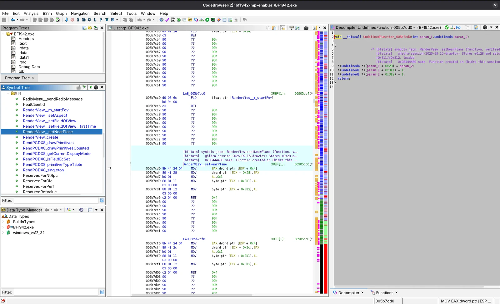

There has been an increase in the number of projects that are using AI to reverse
engineer Battlefield 1942 and Battlefield Vietnam. This site is one of them. I ran
AI almost continuously for a month to crack the Refractor physics engine used by
BF1942, to extract enough knowledge to implement the gameplay recorder.

But there's more to it than "hey Claude, reverse engineer BF1942 and convert it to
work in the browser, make no mistakes". And if you either think this, or are doing
this, then you will find this blog series useful. I like to think of AI as an
overly keen junior staff member, who has incredible knowledge but no life
experience how to apply it. You need to point AI in the right direction, and give
it guardrails to stop it taking short cuts, or wasting tokens down a rabbit hole.

## What irks me the most

For example, what irks me the most, and what I spend the most time on fixing is:

- **Repeating myself over and over.** For example, I do not want to tell every AI
  session this:

> When you implement a mechanic or feature in the browser implementation, you must
> be faithful to the retail client binary, using Ghidra to verify every behaviour
> and value. Do not assume anything, and if you cannot verify it in the game
> binary, call it out to me.

- **Verifying manually only to find it's totally broken or half done.** This is
  where verification scripts and check lists save time.
- **Having to confirm tool calls, and confirming the approach.** After a while, you
  build enough examples for AI to cross reference, and have enough trust in your
  skills and guard rails that AI will get it done. I don't want to type "yes",
  "go ahead", "just FUCKING do it" because the AI stopped to ask me if it should
  continue.

## About me

I am a senior software engineer in my day job, and write code manually for a
living. I can code, but on these battlefield projects I choose not to. The
acceleration factor of AI in the hands of someone who already knows how to code
is extreme. AI has built something I just couldn't have figured out
myself. Reverse engineering, and reading assembly is not my forte. Deploying apps
to the cloud, hosting them reliably and delivering good performance is my niche.
AI bridges the gaps, and I tell it precisely what I want.

I very rarely review its code, but I do pay attention to what it summarises at the
end of a coding session. It's where you can pick up assumptions it made, or
shortcuts it tries to get away with.

## My setup

- Dell XPS 15 9520 laptop. i9 20 core, 64G memory, 1TB SSD
- Running Arch Linux
- Wine used to run BF1942.exe (what I refer to as the retail client)
- Claude Code Desktop on the 'Ultra' subscription. The Ultra is temporary, I will
  revert to Max shortly
- Hermes Desktop with OpenRouter. I will cover this pair in another post

### Tooling

- Ghidra used to reverse engineer the retail client

### Deployment

- Hetzner cloud, hosted in Finland. I'm Australian, but Finland is closer to the
  player base and happened to be the only region with the server specs I wanted.
- 4 core Arm64 / 8GB memory
- Kubernetes running a distribution called k3s from Rancher Labs.
- 1 SQLite DB stores the player and server statistics, and all the recording metadata
- 1 Neo4j DB stores relationships between players, servers and other players.
  Tells you who plays with who, and on what server
- 200GB network attached storage, where everything runs from. The app is heavily
  tailored to be as efficient as possible because the deployment is IO
  constrained. So there are a lot of indexes to make the site feel fast.

## Tell the AI how you work

The very first thing I recommend you do is specify how you work to the AI.

1. **Create CLAUDE.md** At the root of your repo create `CLAUDE.md`. Even though
   it's named after Claude Code, other agents will read instructions from here.
2. **Ask Claude to transcribe** Open Claude Desktop or Claude CLI and tell it:

   > I want to update the Claude instructions file. Transcribe my requirements for me

3. **Say how you like to work** Start instructing Claude how you like to work.
   Mine has been built up over many months. For now, just type your preferences.
   Here are two of mine:

   > Do NOT include your co-authored by-line in my commit messages. You are not allowed to market yourself in my repo

   > Please verify your changes when you finish a task: build the code, run any tests. If you see a gap in the tests, add some and run them until they pass

I also have to remind Claude that we run on a very constrained 4 CPU / 8 GB RAM
environment. This prevents it choosing tooling / writing code that would blow my
resource limits.

## Context is gold dust

My next tip is this: context is valuable, it's what you're paying for and what
contributes to your usage. Use it to your advantage.

Context is the tokens accumulated in every session with the AI. Claude has a 1
million context limit for most of its models. That's HEAPS, but you will hit it
the longer the session runs. Context is basically all the prompts you typed, and
the internal and external responses produced by the AI. This is gold dust, it has
all the pitfalls, issues and fixes you discovered along the way.

Early on in my project, AI would make so many mistakes, it would stray from design
principles and require a lot of manual steering from me. This is a red flag that
you are missing a guardrail. You want to automate your AI sessions as much as
possible. So when I have these sessions where I am intervening, I get to the end
of the session then ask:

> We just implemented a big feature in this session, and encountered a few issues along the way. What would have prevented us encountering these problems, is there a skill or instruction missing that would have helped? If so, please create it

If you do this enough times, you will create guardrails that your AI will follow,
preventing recurring mistakes, and generally doing what you want more often.

I'll leave it here, I'll keep posting advice and will get into the weeds in future
posts. Stay tuned.
