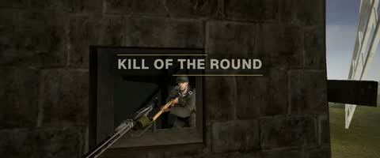
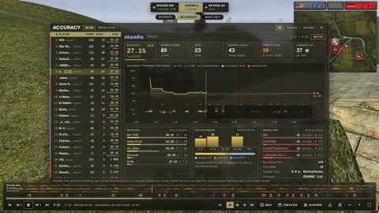

A plain paragraph. It can hold **bold**, *italics*, `inline code` and
[an external link](https://github.com/sila-skandia/bfstats), which opens in a new tab.

## A section heading

Headings at level two start a section. Level three is a sub-section.

### A sub-section

- An unordered list
- keeps ordinary bullets


 

1. **Install** Put the file next to the game.
2. **Turn it on** Type this in the console:

   ```
   plus.recordReplays 1
   ```

3. **Share it** A numbered list is drawn as steps; a bold opening is the step's heading.

```
LD_PRELOAD=/path/recorder.so ./bf1942_lnxded +dedicated 1
```

> A plain quote becomes a side note with an olive rule.

> [!card] For players
> ## The client recorder
> A quote that starts with `[!card]` is a card. The text after it is the kicker,
> and a heading on the next line is the card's title.

> [!card] For server admins
> ## The server recorder
> Two cards in a row sit side by side on a wide screen.
